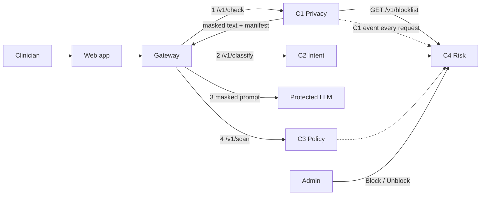
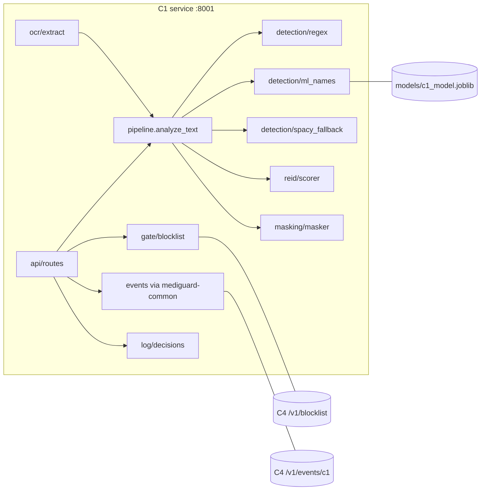
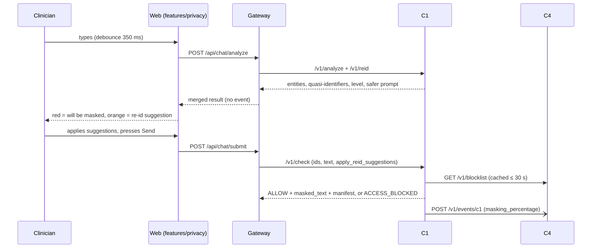
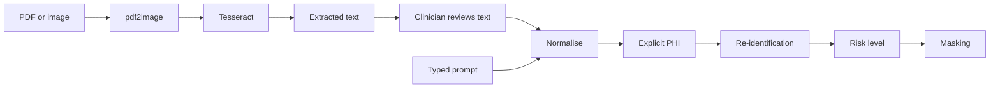
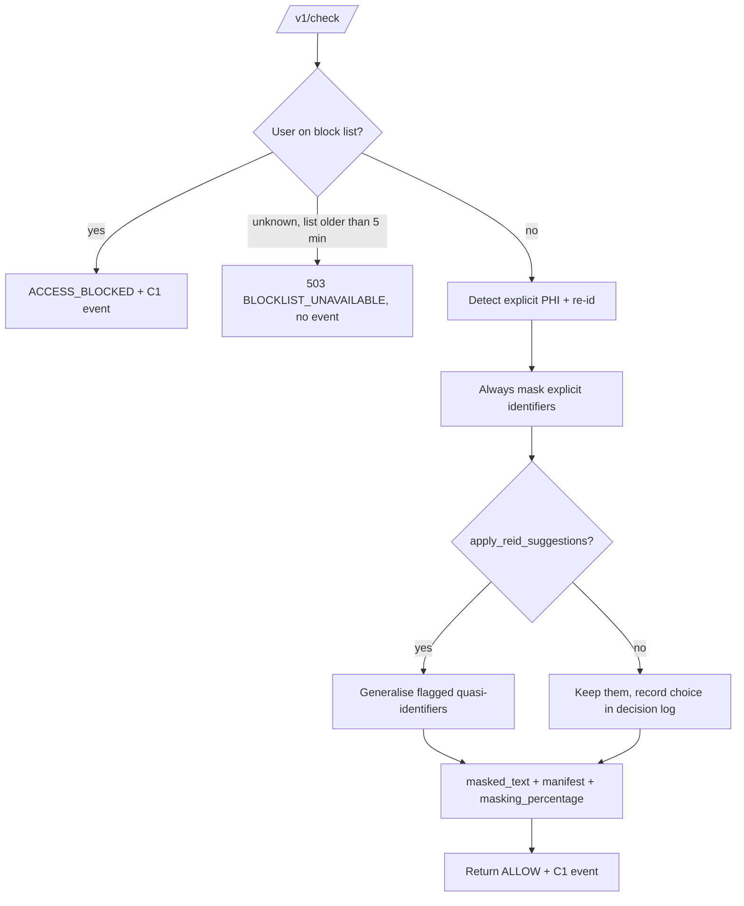

# C1: Real-Time Healthcare Privacy Assistant
## Technical Context and Implementation Guide (integration-aligned)

**Owner:** D.L.A. Wijewickrama (IT23252486), SLIIT, B.Sc. (Hons) IT, Cyber Security
**Supervisor:** Mr. Kavinga Yapa · **Co-supervisor:** Ms. Helani Herath
**Project:** J26-CS-321, A Multi-Layer Security Middleware Framework for Protecting Healthcare LLM Applications
**Version:** October 2026, integration-aligned. Replaces the earlier guide. Every team conflict (K1 to K30) is resolved here, except K28, which is C2's.
**Repository path:** `components/c1-privacy-assistant/` · **Port:** 8001 · **Web feature:** `apps/web/src/features/privacy/`
**Read with:** `PROJECT_BLUEPRINT.md` and `contracts/CONTRACTS.md`. Those two win if anything here disagrees.

---

## 0. How to Read This Guide

### 0.1 Source documents

| Tag | Source | How it is used |
|---|---|---|
| P1 | C1 proposal report (Sept 2026) | Primary source for objectives and requirements, with the edits in Section 29 |
| P4 | Team deck | Framework slides |
| P5 | MediGuardAI React prototype | Product shell; its client-side regex is removed (K18) |
| P6 | C1 working prototype (`c1-privacy-gate`: FastAPI + Falcon UI + `c1_model.joblib`) | Built by the C1 owner |
| TD | Team decisions K1 to K30, the C4 event agreement email, and the integration rules IR1 to IR15 in `PROJECT_BLUEPRINT.md` | **Binding for integration** |

### 0.2 Labels

| Label | Meaning |
|---|---|
| **[CONFIRMED]** | Stated in P1 or P6 |
| **[AGREED]** | Team decision (K or IR number given) |
| **[RECOMMENDED]** | Implementation choice for this project |
| **[OPEN]** | Still to decide; C1-internal only |

### 0.3 The earlier source conflict is resolved

The team topic (P2) described C1 as "Prompt Interceptor: authenticate, phrase matching, PASS/BLOCK". That role is **retired**:

| Old P2 item | Where it went |
|---|---|
| Authentication | Gateway (K4) |
| Phrase matching | Removed (K21) |
| PASS/BLOCK on intent | C2 |

C1 is the **privacy assistant** described in P1, with clinician-approved advice only for re-identification. Explicit identifiers are always masked (K2).

---

## 1. Overall Project Context

### 1.1 Problem [CONFIRMED]
Hospitals deploy LLM assistants. Clinical staff type PHI (names, NIC, MRN, phone, email) into prompts. Cloud guardrails send raw prompts, including PHI, to a vendor. Open guard models need a GPU and use generic safety taxonomies. No existing system combines real-time PHI detection, inference-based re-identification risk and document (OCR) analysis in one self-hostable layer.

### 1.2 Framework [AGREED K22]

| Layer | Name | Owner | Role |
|---|---|---|---|
| C1 | Real-Time Healthcare Privacy Assistant | Linuka | Block-list check, explicit PHI detection (regex + trained name model), re-identification risk scoring with suggestions, OCR, one-way masking `[TYPE_n]`, one event per request to C4 |
| C2 | Semantic Intent Classifier | Nisith | Attack intent in the masked prompt (PASS/BLOCK) |
| LLM | Protected LLM | Team (deployed) | Onsite Ubuntu server, Ollama `qwen2.5:7b`, synthetic hospital database through read-only tools |
| C3 | RAG Output Policy Scanner | Yasas | Checks each answer against the hospital's policy documents, re-checks for leaked identifiers |
| C4 | Heuristic Cross-Session Risk Profiler | Sandul | Per-user risk score from events; admin blocks in C4's dashboard; C1 enforces |
| GW | Gateway | Owner to be named | Login (JWT), ids, calls C1 → C2 → LLM → C3 |

### 1.3 Where C1 fits [AGREED K5, K12]



C1 is called first for every submitted prompt. It does **not** call C2: the gateway does (K5). C1 reads the block list from C4 and sends one event per request to C4.

### 1.4 Boundary with the other components
- **C1** owns the privacy of what the user sends.
- **C2** owns intent.
- **C3** owns what the LLM returns.
- **C4** owns behaviour over time.

A jailbreak without PHI is C2's job. A benign prompt with PHI is C1's job.

---

## 2. Component Overview

### 2.1 Purpose [CONFIRMED]
Protect patient privacy before a prompt reaches the LLM. C1 does this by:
- detecting explicit PHI and inference-based re-identification risk in typed prompts and uploaded documents;
- showing a live risk score with actionable advice;
- masking identifiers before the prompt goes further.

### 2.2 Why it exists [CONFIRMED]
Static de-identification tools (Presidio, i2b2/n2c2 systems) work on finished documents, flag only direct identifiers and give no live feedback. Cloud guardrails are proprietary and cloud-locked.

### 2.3 Scope

| In scope | Out of scope |
|---|---|
| Block-list check, enforcing admin decisions made in C4 (K12) | Login, JWT, roles (gateway, K4) |
| Explicit PHI detection: regex + trained name model + spaCy fallback | Attack-intent detection (C2) |
| Re-identification scoring of quasi-identifiers + generalisation suggestions | Answer checking (C3) |
| OCR for PDF and image uploads through the same pipeline | Risk scoring over time (C4) |
| Live analysis for the typing UI | Unmasking or a PHI vault (removed, K1) |
| One-way masking `[TYPE_n]` + manifest | Phrase matching (removed, K21) |
| One event per request to C4 (`masking_percentage`) | Storing prompt text anywhere |
| Clinical-view privacy feature in the web app; Falcon research demo | Training a new OCR model |

### 2.4 Inputs and outputs

| Direction | Item | Status |
|---|---|---|
| Input | Typed prompt text (from the gateway) | [CONFIRMED] |
| Input | Uploaded PDF, lab report, screenshot (through the gateway) | [CONFIRMED] |
| Input | `request_id`, `org_id`, `user_id`, `session_id` from the gateway | [AGREED K6] |
| Input | Block list from C4 `GET /v1/blocklist?org_id=` | [AGREED K12] |
| Output | Live entities, re-id quasi-identifiers, risk level, safer prompt | [CONFIRMED] |
| Output | Masked text + `placeholder_manifest` to the gateway (which sends it to C2, the LLM and C3) | [AGREED K3, K5] |
| Output | `ACCESS_BLOCKED` decision for blocked users | [AGREED K12, K20] |
| Output | One C1 event per `/v1/check` to C4 | [AGREED K7, K9, K11] |

### 2.5 Users
- **Clinicians** (doctor, nurse) type or upload and see live advice.
- **Admins** never use C1 directly. They block or unblock users in C4's risk dashboard, and C1 enforces those decisions.

In the wording used throughout, the **clinician is the user** and the **patient is the data subject**.

---

## 3. Objectives

The weeks follow the team's 24-week plan (K26).

| # | Objective (P1, reworded per K4) | Due |
|---|---|---|
| O1 | Block-list validation of every request against C4's admin-confirmed list | Week 5 |
| O2 | Hybrid explicit PHI detection benchmarked against Presidio | Week 7 (first table), Week 13 (final) |
| O3 | Inference-based re-identification detection with generalisation suggestions | Week 11 |
| O4 | OCR-based document analysis | Week 12 |
| O5 | Live risk scoring and recommendation interface (Clinical view) | Week 16 |
| O6 | Complete evaluation | Week 20 |

Numeric targets are in Section 22.

---

## 4. Requirements

### 4.1 Functional

| ID | Requirement | Priority | Notes |
|---|---|---|---|
| FR1 | Block-list check before analysis | Must | Authentication is done by the gateway (K4) |
| FR2 | Detect names, NIC, MRN, phone, email, DOB in real time | Must | DOB regex to be added |
| FR3 | Detect quasi-identifier combinations (age, condition, ward/location) | Must | Core contribution |
| FR4 | PDF and image upload with OCR, same pipeline | Should | |
| FR5 | Live risk score as the user types or uploads | Must | Through the gateway `/api/chat/analyze` |
| FR6 | Actionable suggestions (generalised phrasing) | Must | |
| FR7 | Explicit identifiers are always masked before the prompt leaves C1; the clinician approves re-id suggestions | Must | Replaces "automatic masking" (K2) |
| FR8 | PHI-free event to C4 for every submitted request | Must | Agreed fields only (K7, K11) |

### 4.2 Non-functional

| ID | Requirement | Measurable form |
|---|---|---|
| NFR1 | Performance | p95 ≤ 150 ms for `/v1/check` on typed text, CPU (K15) |
| NFR2 | Security | Zero raw PHI in logs, events, outbox or decision log; automated grep test |
| NFR3 | Usability | Apply a suggestion in one click |
| NFR4 | Reliability | Heuristic + spaCy fallback if the ML model fails to load; fail closed on block-list uncertainty |
| NFR5 | Scalability | CPU only |
| NFR6 | Accessibility | Risk shown with text and icons, not colour alone |

### 4.3 Decided behaviours (previously open)

| Topic | Decision |
|---|---|
| Fail behaviour | **Fail closed.** If C1 is down, the gateway withholds (`OUTPUT_WITHHELD`). If the block list cannot be confirmed (no list fresher than 5 minutes), C1 returns `503 BLOCKLIST_UNAVAILABLE` |
| Statelessness | Each request is independent. The only state is the block-list cache, the outbox and the decision log |

---

## 5. Architecture

### 5.1 Style
A single FastAPI service (modular monolith) with internal modules. The Falcon page stays as a standalone research demo in `demo/falcon/`. The product UI is the React Clinical view (K18).

### 5.2 Layers

| Layer | Responsibility |
|---|---|
| API | FastAPI routes, schemas, service-key check (shared package) |
| Gate | Block-list client with cache and stale rules |
| Detection | Regex, ML names, titled-name heuristic, spaCy fallback, overlap resolution |
| Re-identification | Quasi-identifier rarity scoring, suggestions, safer prompt |
| OCR | PDF/image to text, normalisation |
| Masking | `[TYPE_n]`, manifest, `masking_percentage` |
| Events | C1 event to C4 + SQLite outbox (shared package) |
| Decision log | Local, PHI-free record for C1's own evaluation |

---

## 6. Diagrams

These are working diagrams. The figures in the report are redrawn by hand in black and white.

### 6.1 Component diagram


### 6.2 Sequence: typing, then submit


### 6.3 Data flow (OCR branch)


### 6.4 Decision flowchart


---

## 7. Module Breakdown

| Module | Purpose | In / out | Status |
|---|---|---|---|
| M1 Block-list gate | Enforce admin blocks | org, user → allow / blocked / unknown | Client written in the dev build; set to 30 s / 300 s |
| M2 Regex detector | NIC, PHONE, MRN, EMAIL, DOB | text → spans | Built (DOB and normalisation to add) |
| M3 ML name detector | PATIENT_NAME via TF-IDF + LogReg | tokens → spans with confidence | Built (retrain planned) |
| M4 Fallbacks | Titled-name heuristic + spaCy `en_core_web_sm` | text → spans | Heuristic built; spaCy to wire |
| M5 Re-id scorer | Quasi-identifier rarity, level, safer prompt | text → quasi list, score | Built (your `reidentification_check`) |
| M6 OCR | PDF and image to text | file → text | To build |
| M7 Risk level | Explicit + re-id summary for the UI | spans → level | Built |
| M8 Masker | `[TYPE_n]`, manifest, percentage | text + spans → masked text | Built (percentage to add) |
| M9 Event sender | C1 event + outbox | event → C4 | Use `mediguard-common` |
| M10 Decision log | Local PHI-free record per request | → SQLite | To build |
| M11 Clinical view feature | Live underline, tooltip, apply | web | To build (Weeks 14 to 16) |
| M12 Falcon demo | Standalone research UI | | Built |

---

## 8. End-to-End Workflow

1. The clinician logs in through the gateway (JWT). The gateway knows `org_id` and `user_id`, and opens a `session_id`.
2. While the clinician types, the web app calls `/api/chat/analyze` (debounced 350 ms). The gateway calls C1 `/v1/analyze` and `/v1/reid`. No events are sent at this stage.
3. The UI underlines explicit PHI in red ("will be masked") and re-identification risk in orange (a suggestion). Hovering shows the advice, and one click applies it.
4. For an upload, the gateway calls C1 `/v1/ocr`. The clinician sees the extracted text, and analysis continues as for typed text.
5. On Send, the gateway creates `request_id` and calls C1 `/v1/check` with `apply_reid_suggestions`.
6. C1 checks the block list.
   - **Blocked user:** C1 returns `ACCESS_BLOCKED` and still sends its event.
   - **Otherwise:** C1 masks every explicit identifier, applies the approved re-id generalisations, and returns the masked text, the manifest and `masking_percentage`. Then it sends its event.
7. The gateway continues with C2, the LLM and C3. Placeholders stay in the answer the clinician sees (K1).

Errors and edge cases are in Section 25.

---

## 9. Data Structures

The exact schemas are in `contracts/schemas/`. The examples below are illustrative.

### 9.1 `/v1/analyze`
```json
// request
{ "text": "Patient Nimal Perera 0771234567, review P0012" }
// response
{ "entities": [
    { "type": "PATIENT_NAME", "start": 8, "end": 20, "value": "Nimal Perera", "confidence": 0.91, "source": "ml" },
    { "type": "PHONE", "start": 21, "end": 31, "value": "0771234567", "confidence": 0.99, "source": "regex" } ],
  "explicit_risk": { "score": 40, "level": "Medium" }, "latency_ms": 12 }
```
`value` is returned to the gateway only, for underlining. It is never logged or stored. `P0012` is not an entity (IR12).

### 9.2 `/v1/reid`
```json
{ "quasi_identifiers": [ { "type": "AGE", "start": 0, "end": 11, "match": "94-year-old", "rarity": "high", "suggestion": "elderly patient" } ],
  "count": 3, "score": 78, "level": "High", "explanation": "...", "safer_prompt": "..." }
```

### 9.3 `/v1/check` (contract `c1_check_request` / `c1_check_response`)
```json
// request
{ "request_id": "req_20261020_000123", "org_id": "org_001", "user_id": "user_001", "session_id": "sess_01JAB3K9Q2",
  "text": "Patient Nimal Perera NIC 199512345678, review P0012", "apply_reid_suggestions": true }
// response
{ "request_id": "req_20261020_000123", "decision": "ALLOW",
  "masked_text": "Patient [PATIENT_NAME_1] NIC [NIC_1], review P0012",
  "placeholder_manifest": ["[PATIENT_NAME_1]", "[NIC_1]"], "masking_percentage": 47.1,
  "entity_counts": { "PATIENT_NAME": 1, "NIC": 1 }, "reid": { "level": "Low", "score": 0, "applied": true },
  "user_message_code": null, "latency_ms": 42 }
```

### 9.4 C1 event to C4 (agreed by email, contract `c1_event`)

| Field | Value |
|---|---|
| `event_id` | `evt-c1-<uuid4>`, never reused |
| `org_id`, `user_id`, `request_id`, `session_id` | Copied from the request |
| `event_timestamp` | UTC time `/v1/check` finished, ISO 8601 with `Z` |
| `masking_percentage` | `round(100 × masked_chars / len(original_text), 1)`. `masked_chars` = total length of replaced explicit spans. Re-id generalisations do not count (IR7) |

**Sent for every `/v1/check`:**
- including 0% masked requests;
- including blocked users, where detection still runs so the number is real (IR14).

**Not sent:**
- for `/v1/analyze`, `/v1/reid` or `/v1/ocr`;
- when C1 returns `503`.

### 9.5 Local decision log (C1 only, never sent)

| Field | Note |
|---|---|
| `request_id`, `org_id`, `user_id`, `session_id`, `ts` | ids |
| `decision` | ALLOW / ACCESS_BLOCKED / BLOCKLIST_UNAVAILABLE |
| `entity_counts` | types and counts only |
| `masking_percentage`, `reid_level`, `reid_score`, `reid_applied` | for evaluation |
| `name_detector` | ml / heuristic |
| `latency_ms` | |

This keeps the richer data you need for your own analysis without changing the agreed event.

### 9.6 Training dataset (HC-PII-Corpus) [CONFIRMED P6]
`sensitivity_dataset.csv`: text, entity type (PATIENT_NAME, MRN, PHONE, EMAIL, NIC, LOCATION, ADDRESS, AGE, DOB, NONE), risk (high/medium/low). The plan is 3k to 5k rows; a 3,240-row version exists. It is synthetic, with Sri Lankan formats.

---

## 10. APIs and Interfaces

### 10.1 Endpoints

| Method | Path | Called by | Event |
|---|---|---|---|
| GET | `/health` | Compose, gateway | no |
| POST | `/v1/analyze` | Gateway (typing) | no |
| POST | `/v1/reid` | Gateway (typing) | no |
| POST | `/v1/check` | Gateway (submit) | **yes** |
| POST | `/v1/ocr` | Gateway (upload; PDF/PNG/JPG, ≤ 10 MB, ≤ 20 pages) | no |

- All endpoints except `/health` need `X-Service-Key` from the gateway (checked by `mediguard-common`).
- Old prototype routes (`/predict`, `/chat`, `/ui`) move to `demo/falcon/` or are removed.
- CORS is closed: C1 is internal-only.

### 10.2 Integration calls

| Direction | Call | Detail |
|---|---|---|
| C1 → C4 | `GET /v1/blocklist?org_id=` | Cache 30 s; use the last good list up to 300 s if C4 is down |
| C1 → C4 | `POST /v1/events/c1` | Background; 3 retries (0.5 s, 2 s, 5 s) then outbox, resent every 30 s |
| Gateway → C1 | the four endpoints above | timeouts 2 s (check), 10 s (OCR) |

---

## 11. Data Storage

| Store | Content | Location |
|---|---|---|
| `c1_model.joblib` | Vectorizer, type model, risk model | Drive; `models/manifest.json` (SHA-256, sklearn version, data version, metrics) in Git (K29) |
| `configs/reid_lists.yaml` | Rare conditions, small towns, big cities, age thresholds | Git |
| `c1.db` (SQLite volume) | Event outbox + decision log | Docker volume `c1_db` |
| Block list | Cache in memory only; the source of truth is C4 | |

**Dropped:**
- the PostgreSQL entity store (K13);
- the shared event table (K8).

**No raw PHI is persisted.** Uploads are processed in memory and discarded.

---

## 12. Algorithms and Logic

### 12.1 Explicit PHI detection [CONFIRMED P6, extended]

**Regex:**

| Entity | Pattern |
|---|---|
| PHONE | `(?:\+94\|0)[\s\-]?\d{2}[\s\-]?\d{3}[\s\-]?\d{4}` |
| NIC | `\d{9}[VvXx]` or `\d{12}` |
| MRN | `MRN:? \d{4,10}` |
| EMAIL | standard pattern |
| DOB | `DOB`, `date of birth` or `born on` followed by a date (**to add**) |

- **Normalisation before regex:** collapse spaced digits ("0 7 7 1 …"), turn `[at]` into `@`.
- **ML names:** TF-IDF `char_wb` 2 to 4-grams + Logistic Regression per token. Keep PATIENT_NAME at confidence ≥ 0.65.
- **Fallbacks:** the titled-name heuristic ("Patient X Y", "Dr X") and spaCy PERSON when the model fails to load.
- **Overlaps:** the longest span wins, then the highest confidence.
- **Exclusions:** `P\d{4}` and `D\d{3}` ids are never entities (IR12).

### 12.2 Re-identification scoring [CONFIRMED P6]
Quasi-identifiers:
- AGE (extreme: under 5 or over 85)
- rare CONDITION
- WARD
- small TOWN vs big city

Rarity weights: high 3, medium 2, low 1. Raw = sum of weights.

| Condition | Level | Score |
|---|---|---|
| count ≥ 3 or raw ≥ 7 | High | min(60 + raw × 6, 100) |
| count = 2 or raw ≥ 4 | Medium | rule based |
| otherwise | Low | rule based |

Suggestions generalise, for example:
- "94-year-old" becomes "elderly patient";
- a condition becomes "a chronic condition";
- "Galle ward 3" becomes "the hospital".

This is **inspired by** k-anonymity (Sweeney 2002). It is **not** a k-anonymity implementation, so claim it that way.

### 12.3 Live risk level [CONFIRMED P6, one scheme chosen]
- **Report scheme:** entity weights (high 30, medium 20, low 10) combined with the re-identification level, shown as Low/Medium/High.
- **Dropped:** the P3 scheme (Name 20, MRN 30, …), so the report documents one scheme only.

### 12.4 Masking [AGREED K1, K2, K3]
- Replace each explicit span with `[TYPE_n]`, numbered per request. The same value gets the same token.
- The manifest lists tokens only.
- It is one-way: nothing stores the mapping.

### 12.5 Known limitations
- The rule-based safer prompt can produce awkward grammar ("elderly a chronic condition patient").
- The curated lists are limited.
- Short first names ("Nimal") may get low confidence until the model is retrained on the first-name-heavy set.

---

## 13. Machine Learning Component

| Item | Detail |
|---|---|
| Is ML required? | Yes for unseen names; not for structured identifiers |
| Model | Two Logistic Regression classifiers (entity type, risk) on a shared TF-IDF vectorizer |
| Pre-trained? | No; trained by the owner. Only spaCy is pre-trained |
| Training data | Synthetic HC-PII-Corpus |
| Validation | i2b2/n2c2 2014 **only if access is granted**; otherwise do not claim it |
| Features | Character n-grams 2 to 4 |
| Earlier result | Risk accuracy 0.91 on 666 rows (not final) |
| Target | At least Presidio overall on the same held-out set; higher recall on unseen Sri Lankan names |
| Risks | Name leakage between train and test; template overfitting |
| Controls | **Split by name**; hard negatives (Parkinson, Addison, Down, Crohn); per-type P/R/F1; the scikit-learn version is pinned in the manifest |

Panel defence of synthetic data:
- Sri Lankan NIC, phone and name formats are absent from public corpora.
- There is precedent for synthetic PHI training.
- Real-style validation uses i2b2/n2c2 if access is granted.

---

## 14. Security Design

| Concern | Design | Label |
|---|---|---|
| User authentication | Gateway JWT and roles | [AGREED K4] |
| Service authentication | `X-Service-Key`; C1 accepts only the gateway's key | [AGREED K23] |
| Block list | Read-only from C4; admin-confirmed | [AGREED K12] |
| PHI in logs, events, outbox | Never; ids, types, counts and percentages only | [CONFIRMED NFR2] |
| PHI in transit | Internal Docker network; only the gateway is exposed | [AGREED] |
| PHI at rest | Not stored; uploads processed in memory | [RECOMMENDED] |
| Input validation | Pydantic; text ≤ 8000 chars; file ≤ 10 MB, ≤ 20 pages, MIME by content | [RECOMMENDED] |
| Model integrity | SHA-256 check against `models/manifest.json` at start | [RECOMMENDED] |
| Fail behaviour | Closed (Section 4.3) | [AGREED] |
| Re-id override | The clinician's choice is recorded in the local decision log only; explicit identifiers cannot be overridden | [AGREED K2] |

Do not claim HIPAA or Sri Lankan PDPA compliance. They motivate the work only.

---

## 15. Threat Model

| Threat | Example | Mitigation | Residual risk |
|---|---|---|---|
| PHI leaks to LLM | Name typed in prompt | Detection + always-mask | Missed names (recall < 100%); C3 leak re-check is the second line |
| Indirect re-identification | "94-year-old HIV patient in Galle ward 3" | Quasi-identifier scoring + suggestions | Curated lists are finite; clinician may decline |
| PHI in documents | Screenshot of a lab report | OCR through the same pipeline | OCR errors on poor scans |
| Evasion | "0 7 7 1 2 3 4 5 6 7" | Normalisation before regex | Obfuscation partly succeeds |
| Blocked user retries | New session | Block list keyed on (org, user) | Account sharing |
| Stale block list | C4 down | Cache ≤ 30 s, max stale 300 s, then 503 | Up to 5 min delay while C4 is down |
| Log leakage | Raw text in debug logs | Shared no-PHI logger + grep test | Developer error |
| Model tampering | Replaced joblib | Hash check | Low |
| Malicious upload | Crafted PDF | Size, type and page limits, no execution | Library CVEs |
| Forged caller | Something other than the gateway calls `/v1/check` | Service key per caller | Key leak |

---

## 16. Technology Stack

| Area | Choice |
|---|---|
| Language | Python 3.11 (K30) |
| API | FastAPI + Uvicorn, Pydantic v2, pydantic-settings |
| Shared | `mediguard-common` (auth, event sender + outbox, ids, no-PHI logging) |
| ML | scikit-learn, joblib, pandas |
| NLP fallback | spaCy `en_core_web_sm` |
| OCR | Tesseract (pytesseract) + pdf2image (EasyOCR only if the Week 11 trial favours it) |
| Baseline | Microsoft Presidio (offline benchmark only) |
| Storage | SQLite (outbox, decision log) |
| Tests | pytest, httpx, jsonschema (contracts), Playwright (UI, optional) |
| Product UI part | React + TypeScript feature folder in `apps/web` |
| Research UI | Falcon (HTML/JS), unchanged |
| Deployment | Docker (python:3.11-slim, non-root), Compose |

Not used by C1: PostgreSQL, Redis, Celery.

---

## 17. Implementation Plan (24 weeks, shared gates)

| Week | Tasks | Done when |
|---|---|---|
| 1 to 2 (G0) | Proposal edits (Section 29); move code into `components/c1-privacy-assistant/` | Supervisor accepts scope |
| 3 | `/health`; CI path filter; ruff + pytest | CI green |
| 4 | Event sender + outbox via `mediguard-common`; `stubs/c4_stub.py`; contract tests | Contract tests pass |
| 5 | Block-list client (30 s / 300 s / 503); DOB + normalisation; P/D id exclusion | O1 done; unit tests for every regex |
| 6 | Retrain names (split by name, hard negatives); model manifest; spaCy fallback | Per-type P/R/F1 on validation |
| 7 | Presidio benchmark script; latency script | First benchmark table; p95 measured |
| 8 (G2) | Sign contracts | Signed |
| 9 to 10 (G3) | MVP `/v1/check` with draft model; gateway calls real C1 | Demo: blocked user, masked prompt, event received |
| 10 to 11 | Re-id lists to YAML; re-id test set; double annotation, kappa | O3 done; kappa ≥ 0.75 |
| 11 to 12 | `/v1/ocr`; OCR test set (3 tiers); OCR engine trial | O4 done |
| 12 (G4) | Freeze and hash C1 test sets; give PHI items to the system set | Tag `c1-frozen-v1` |
| 13 (G5) | Final name model on the frozen split | Final metrics + manifest |
| 14 to 16 | `apps/web/src/features/privacy`: debounced analyze, underlines, tooltip, one-click apply, re-id toggle, "explicit details will be masked" note; delete prototype regex | O5 done |
| 14 to 18 | Security tests; performance on the middleware host | Checklist done |
| 17 to 20 | Evaluation (Section 22) | O6 done; tables with intervals |
| 21 to 24 | Report, dataset card, model card, viva | Submitted |

Critical path: datasets and evaluation sets, then benchmarks. Highest risks: OCR quality and real-data validation access.

---

## 18. Repository Structure

```text
components/c1-privacy-assistant/
├── src/c1/
│   ├── main.py                 # FastAPI app factory, routes mounted
│   ├── config.py               # pydantic-settings (C1_* env vars)
│   ├── schemas.py              # request/response models (mirror contracts)
│   ├── pipeline.py             # analyze_text(): one function used by analyze, check, ocr
│   ├── api/{health.py, analyze.py, reid.py, check.py, ocr.py}
│   ├── gate/blocklist.py
│   ├── detection/{regex.py, normalise.py, ml_names.py, titled_names.py, spacy_fallback.py, overlaps.py}
│   ├── reid/{scorer.py, suggestions.py}
│   ├── masking/masker.py
│   ├── ocr/extract.py
│   └── log/decisions.py
├── demo/falcon/                # standalone research UI
├── training/
│   ├── notebooks/              # thin Colab notebooks (optional for sklearn)
│   ├── scripts/{build_corpus.py, split_by_name.py, train_names.py, evaluate_names.py}
│   └── configs/train.yaml
├── data/
│   ├── README.md               # dataset card
│   ├── manifest.json           # file names + SHA-256 (big files on Drive)
│   └── samples/                # small synthetic samples safe to commit
├── models/
│   ├── README.md               # where to put c1_model.joblib
│   └── manifest.json
├── evaluation/{presidio_benchmark.py, reid_eval.py, ocr_eval.py, latency.py, masking_utility.py}
├── stubs/{c4_stub.py, blocklist.json}
├── configs/{default.yaml, reid_lists.yaml}
├── tests/{unit,integration,contract,security,performance}/
├── Dockerfile                  # copies packages/mediguard-common, installs Tesseract
├── docker-compose.dev.yml      # c1 + c4_stub
├── pyproject.toml
├── .env.example
└── README.md
```

---

## 19. Implementation Guidance

### 19.1 Order of work
1. Fix correctness first: DOB regex, normalisation, P/D exclusion, name retraining.
2. Build `/v1/check` with the block list and the event.
3. Build the evaluation scripts **before** OCR, because the results are the thesis.
4. Build OCR, then the Clinical view feature.

### 19.2 Patterns
- Detectors are pure functions: text in, spans with offsets out.
- One shared `analyze_text()` serves `/v1/analyze`, `/v1/check` and `/v1/ocr`.
- Events are sent through `mediguard_common.events.EventSender("/v1/events/c1")`, which is never awaited in the request path.
- Configuration lives in YAML and environment variables, never as constants in code.

### 19.3 Mistakes to avoid
- Claiming k-anonymity is implemented.
- Claiming "automatic masking" for re-id items (only explicit identifiers are automatic).
- Claiming the model is pre-trained.
- Logging the prompt for debugging.
- Using the same names in train and test.
- Mentioning i2b2/n2c2 results before access is granted.
- Masking `P0012`-style ids.

### 19.4 Configuration

| Env var | Example | Purpose |
|---|---|---|
| `MG_SERVICE_NAME` / `MG_SERVICE_KEY` / `MG_ACCEPTED_KEYS` | `c1` / `…` / `gateway:…` | Shared auth (contracts §5) |
| `MG_C4_URL` | `http://c4:8004` | Block list + events |
| `MG_OUTBOX_PATH` | `/data/c1.db` | Outbox + decision log |
| `C1_BLOCKLIST_CACHE_SECONDS` / `C1_BLOCKLIST_MAX_STALE_SECONDS` | 30 / 300 | Gate |
| `C1_MODEL_PATH` / `C1_NAME_THRESHOLD` | `models/c1_model.joblib` / 0.65 | Names |
| `C1_MAX_UPLOAD_MB` / `C1_MAX_PAGES` | 10 / 20 | OCR |

---

## 20. Integration with Other Components

| With | Direction | What | Status |
|---|---|---|---|
| Gateway | GW → C1 | `/v1/analyze`, `/v1/reid`, `/v1/check`, `/v1/ocr` | Contract `c1_check_*` |
| Gateway → C2, LLM, C3 | indirect | Masked text and manifest from C1 are passed on by the gateway | K3, K5 |
| C4 | C1 → C4 | `GET /v1/blocklist?org_id=` | K12 |
| C4 | C1 → C4 | `POST /v1/events/c1` | K7, K9, K11 |
| C3 | none directly | C3 uses the manifest to avoid counting placeholders as leaks | K3 |
| Web app | via gateway only | `features/privacy` calls `/api/chat/analyze`, `/api/chat/ocr` | K18 |

**Developing alone:**

```bash
cd components/c1-privacy-assistant
docker compose -f docker-compose.dev.yml up        # c1 + c4_stub (validates events against contracts)
curl -s -X POST localhost:8001/v1/check -H "X-Service-Key: $GW_KEY" -H 'Content-Type: application/json' \
  -d '{"request_id":"req_20261020_000001","org_id":"org_001","user_id":"user_001","session_id":"sess_dev",
       "text":"Patient Nimal Perera NIC 199512345678, 94-year-old in Galle ward 3, review P0012"}'
```

To check masking utility against the real model, open a tunnel to the onsite LLM with `ssh -L 8010:localhost:8010 <user>@<llm-server>`.

---

## 21. Testing Strategy

| ID | Level | Case | Expected |
|---|---|---|---|
| C1-U-01 | Unit | NIC `199512345678`, `951234567V` | NIC |
| C1-U-02 | Unit | `077 123 4567`, `+94771234567`, `0 7 7 1 2 3 4 5 6 7` | PHONE |
| C1-U-03 | Unit | `P0012`, `D003` | not masked |
| C1-U-04 | Unit | Same name twice | same `[PATIENT_NAME_1]` |
| C1-U-05 | Unit | `masking_percentage` on a fixed string | exact value |
| C1-U-06 | Unit | Model file missing | heuristic + spaCy, `/health` says `heuristic` |
| C1-U-07 | Unit | Safe prompt | Low, no entities |
| C1-I-01 | Integration | Blocked user | `ACCESS_BLOCKED`, event sent |
| C1-I-02 | Integration | C4 down, cache 2 min old | ALLOW with cached list |
| C1-I-03 | Integration | C4 down, cache older than 5 min or never loaded | `503 BLOCKLIST_UNAVAILABLE`, no event |
| C1-I-04 | Integration | C4 down at send time | event in outbox, sent later |
| C1-C-01 | Contract | Every event and `/v1/check` response | validates |
| C1-S-01 | Security | 500 PHI prompts, grep logs/DB/outbox for values | zero hits |
| C1-S-02 | Security | Wrong key, 9,000 chars, 50 MB upload | 401, 422, 413 |
| C1-P-01 | Performance | 1,000 typed `/v1/check` | p95 ≤ 150 ms |
| C1-UI-01 | UI | Type a name, then apply a suggestion | Underline appears, then clears |

Edge cases:
- empty or very long prompt
- repeated entity
- name inside a medical term
- mixed case
- Sinhala/Tamil text (out of scope; must not crash)
- prompt that is only a number
- overlapping spans

---

## 22. Evaluation and Metrics

| Metric | How | Target |
|---|---|---|
| Entity P/R/F1 per PHI type | Held-out set vs Presidio | At least equal overall; higher recall on unseen names |
| Re-identification flagging | Risky vs safe set, PR curve | Report recall at a false-alert rate of 10% or less |
| OCR | CER and end-to-end PHI F1 by quality tier | Clean tier within 0.10 F1 of typed text |
| Latency | p50/p95 on CPU | p95 ≤ 150 ms |
| Label quality | Cohen's kappa, 120 double-annotated items | ≥ 0.75 |
| Masking utility | Protected LLM answer quality, masked vs unmasked, 50 prompts | Report only |
| Usability | Clicks to apply a fix | One |
| System contribution | PHI reaching the LLM: arm `none` vs `c1` (shared ablation) | Report with interval |

Report confidence intervals (bootstrap) for every metric.

---

## 23. Research Contribution

| Claim | Strength |
|---|---|
| Real-time PHI detection while the prompt is written | Moderate; engineering plus UX |
| Inference-based re-identification scoring for LLM prompts, with generalisation advice | Main contribution; modest, rule-based |
| Unified typed and OCR pipeline | Moderate |
| Self-hostable, CPU-only | Practical value |
| Sri Lankan identifier formats | Local relevance |
| Measured privacy contribution inside a layered defence (system ablation) | Supports the team claim |

The components are standard (regex, TF-IDF, Logistic Regression). The contribution is the combination, the prompt setting and the advice-giving re-identification layer. Say "to the best of my literature review"; never say "first ever".

---

## 24. Existing Solutions and Comparison

| Solution | What it does | Gap relative to C1 |
|---|---|---|
| Microsoft Presidio | Regex + NER PII detection | Misses unseen local names; no live feedback; no inference risk |
| i2b2/n2c2 systems | Static note de-identification | Offline; direct identifiers only |
| Cloud guardrails (Azure, Bedrock, Model Armor) | Managed screening | Send raw PHI to a vendor |
| NeMo / LLM Guard | Filtering | No masking advice; not prompt-composition time |
| Llama Guard, ShieldGemma, Granite Guardian | Safety classification | Generic; GPU |
| Google DLP, AWS Comprehend Medical | PII/PHI detection | Cloud; detection only |
| k-anonymity (Sweeney 2002), El Emam and Dankar 2008, Lee and Lee 2017 | Re-identification theory | Not operationalised for prompts |

Name the tools in Table 1.1 of the proposal instead of columns A to D, and verify each tick against the tool's documentation.

---

## 25. Failure Scenarios

| Scenario | Impact | Handling |
|---|---|---|
| ML model fails to load | Names missed | Heuristic + spaCy; `/health` shows `heuristic`; warning in the decision log |
| Regex false positive | Over-masking | Measured in evaluation; patterns tuned on validation |
| Missed name | PHI leak | C3 leak re-check is the second line; recall reported honestly |
| OCR garbles text | Missed PHI | Clinician reviews OCR text before analysis |
| C4 down | Block list ages | Cache, then stale up to 5 min, then 503 (fail closed) |
| C4 down at event time | Event delayed | Outbox resend |
| Latency spike | Laggy UI | Debounce; cancel stale requests in the web feature |
| Over-masking hurts answers | Poor LLM answer | Masking-utility test |
| Wrong user blocked | Access denied | Admin unblocks in C4; C1 follows within 30 s |
| Large file | Memory | Limits |

---

## 26. Deployment

| Item | Plan |
|---|---|
| Local | `docker compose -f components/c1-privacy-assistant/docker-compose.dev.yml up` |
| Integrated | `infra/compose/docker-compose.yml` on the middleware host; C1 is internal on 8001 |
| Image | python:3.11-slim + tesseract-ocr; non-root; healthcheck `/health` |
| Volumes | `c1_db` (SQLite), model folder mounted read-only |
| Models | Download by manifest (`scripts/download_models.py c1`); hash checked at start; restart after retraining (`--reload` does not reload joblib) |
| Versioning | Git tags `c1-vX.Y`; model file named with date and metrics |
| Monitoring | `/health`, JSON logs (no PHI), latency in the decision log |

---

## 27. Documentation Needs

- `components/c1-privacy-assistant/README.md`: setup and run.
- OpenAPI from `/docs`, exported to `docs/api/c1.json`.
- Dataset card (`data/README.md`) and model card (`models/README.md`).
- Evaluation report: tables and PR curve.
- Clinician guide for the Clinical view (reading underlines, applying fixes).
- Report chapters and viva slides, with hand-drawn black-and-white figures.

---

## 28. Viva Preparation

| # | Question | Short answer |
|---|---|---|
| 1 | What is your component? | A real-time privacy assistant that stops patient information reaching the AI, even when no name is written |
| 2 | What is new? | Live explicit-PHI detection combined with inference-based re-identification scoring and advice, in one self-hosted layer. The components are standard |
| 3 | Is the model pre-trained? | No. I trained Logistic Regression on TF-IDF features; only spaCy is pre-trained |
| 4 | Why Logistic Regression? | CPU only, fast, explainable, enough for character-level name patterns |
| 5 | Why synthetic data? | Public corpora lack Sri Lankan formats; real PHI needs ethics approval; there is precedent |
| 6 | Is it k-anonymity? | No, it is inspired by it: rule-based rarity scoring |
| 7 | How do you compare with Presidio? | Same held-out set; higher recall on unseen names is the target; Presidio cannot score inference risk |
| 8 | What if a name is missed? | C3 re-checks the answer for leaks; recall is reported honestly |
| 9 | Why is masking automatic for some items but not others? | Explicit identifiers are never needed by the AI, so they are always masked. Re-identification hints can carry clinical meaning, so the clinician decides |
| 10 | What does C1 send to C4? | One event per request: ids, time and the masking percentage. No text, no entity values |
| 11 | Who blocks users? | An admin, in C4's dashboard, when C4 recommends it at P1. C1 enforces on the next request within 30 seconds |
| 12 | How do you prove logs are private? | An automated test greps logs, the outbox and the decision log for the test values |
| 13 | Why not authenticate in C1? | Identity is handled once, in the gateway. C1 only enforces block decisions |
| 14 | What if C1 or C4 is down? | C1 down: the request is withheld. C4 down: C1 uses a cached list for up to 5 minutes, then refuses |
| 15 | Limits? | Curated lists, English only, rule-based advice grammar, synthetic data, OCR quality |
| 16 | Future work? | Sinhala/Tamil, learned re-identification from population statistics, better OCR, a C4 rule based on masking behaviour |

---

## 29. Decisions Recorded and Remaining Items

### 29.1 Resolved (previously "need confirmation")

| # | Question | Decision |
|---|---|---|
| 1 | C1 scope: Prompt Interceptor or privacy assistant | Privacy assistant (P1); phrase matching removed (K21) |
| 2 | Authentication in C1? | No. Gateway (K4); C1 does the block-list check |
| 3 | Automatic vs clinician-approved masking | Explicit always masked; re-id approved by the clinician (K2) |
| 4 | Latency target | 150 ms p95 (K15) |
| 5 | Risk scoring scheme | P6 scheme (Section 12.3) |
| 6 | PostgreSQL entity store | Dropped (K13) |
| 7 | Block-list store and sync | C4 `GET /v1/blocklist`, cache 30 s (K12) |
| 8 | Audit event schema | Agreed C1 event (email; K7, K11) |
| 9 | Payload to C2 | Gateway sends `c2_classify_request` (K5) |
| 10 | Fail open or closed | Closed |
| 13 | Falcon vs prototype UI | Prototype React app is the product; Falcon stays as the research demo (K18) |
| 15 | Title page | Mr. Kavinga Yapa, Ms. Helani Herath, J26-CS-321 (K25) |

### 29.2 Still yours to decide (no effect on others)

| # | Item | By |
|---|---|---|
| 11 | OCR engine (Tesseract default) | Week 11 trial |
| 12 | i2b2/n2c2 access: apply or remove the claim | Week 6 |
| 14 | Sinhala/Tamil: assume out of scope | Week 2 note in the report |
| 16 | spaCy wired as a fallback | Week 6 |
| 17 | DOB regex | Week 5 |

### 29.3 Proposal edits (K22, K25, K26)

1. Title page per K25.
2. FR1 → "Block-list check" (authentication by the gateway).
3. FR7 → "Explicit identifiers are always masked; the clinician approves re-identification suggestions".
4. Placeholder format `[TYPE_n]` with a manifest.
5. Events go over HTTP to C4, not to a shared table.
6. Timeline in the 24-week plan, with contract freeze at Week 8.
7. Latency target 150 ms.

---

## 30. Implementation Readiness Checklist

| Item | Status |
|---|---|
| Scope agreed with the team | Done (K decisions) |
| Contracts drafted (`c1_check_*`, `c1_event`) | Done (rc2); sign at G2 |
| Detector (regex + ML) | Working in prototype |
| Re-identification scorer | Working |
| Falcon UI | Working |
| Dev-build `/v1/check`, masking, block-list client | Exists in `mediguard.zip`; port into the repository layout |
| `masking_percentage` + agreed event | To do (Week 4) |
| DOB, normalisation, P/D exclusion | To do (Week 5) |
| Name retraining split by name | To do (Week 6) |
| spaCy fallback | To do (Week 6) |
| Presidio benchmark | To do (Week 7) |
| Re-id test set + kappa | To do (Weeks 10 to 11) |
| OCR | To do (Weeks 11 to 12) |
| Clinical view feature | To do (Weeks 14 to 16) |
| Evaluation | Weeks 17 to 20 |

---

## 31. Final Summary

**C1 is the privacy gate of the framework.** For every submitted prompt, the gateway calls C1, and C1:
- checks the user against the admin-confirmed block list from C4;
- detects explicit PHI with regex and a trained name classifier;
- scores re-identification risk from quasi-identifier combinations;
- reads uploads with OCR through the same pipeline;
- always masks explicit identifiers as `[TYPE_n]`, and applies the generalisations the clinician approved;
- returns the masked text and manifest;
- sends one PHI-free event (`masking_percentage`) to C4.

While the clinician types, the Clinical view shows live underlines and advice.

**Built today:** the detector, the re-identification scorer, Falcon, the trained model, and a dev-build `/v1/check` with masking and a block-list client.
**To build:** the agreed event, DOB and normalisation, retraining, spaCy fallback, OCR, the Clinical view feature, the Presidio benchmark and the evaluation.
**Be honest about:** synthetic training data, rule-based (not true k-anonymity) re-identification, and novelty in the combination and the setting.
