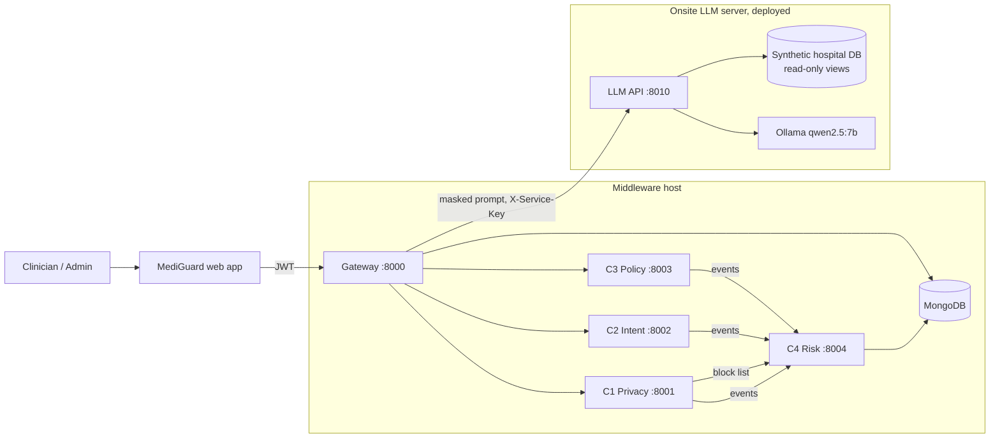
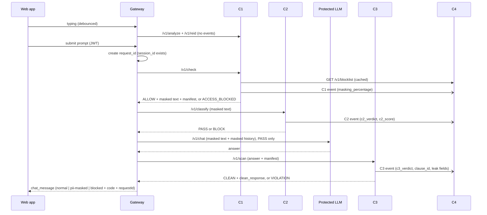

# MediGuard AI: Product Blueprint v3.1

**Project:** J26-CS-321, A Multi-Layer Security Middleware Framework for Protecting Healthcare LLM Applications (SLIIT IT4010)
**Supervisor:** Mr. Kavinga Yapa · **Co-supervisor:** Ms. Helani Herath

**Team:**

| Component | Owner |
|---|---|
| C1 Real-Time Healthcare Privacy Assistant | Linuka (D.L.A. Wijewickrama) |
| C2 Semantic Intent Classifier | Nisith (N.T. Lokuvithana) |
| C3 RAG Output Policy Scanner | Yasas (Y.N. Maddumage) |
| C4 Heuristic Cross-Session Risk Profiler | Sandul (S.D.W. Gunaratne) |

**Status:**
- This is version 3.1. It replaces v2.0, `PROJECT_BLUEPRINT.md` v1 and the integration analysis.
- Change from 3.0: the four component blueprints now live **inside their component folders** (`components/cN-*/BLUEPRINT.md`). The other blueprints stay in `docs/blueprints/`. Section 11.10 and `docs/runbooks/repo-setup.md` explain how to create the repository.
- It applies the team's answers on conflicts K1 to K30, the C4 event agreement (email and field tables) and the onsite deployment of the protected LLM.
- The four component blueprints have been **updated in place** to match it.
- Two items are still open (Section 18). Nothing else in this pack conflicts.

**Label convention:**

| Label | Meaning |
|---|---|
| **K1 to K30** | Team conflicts and their final decisions |
| **IR1 to IR15** | Integration rules that settle the questions the agreement left open |

Component-internal labels (for example C3's own D and N ids) stay inside each component blueprint.

| File (path in the repository) | What it is |
|---|---|
| `PROJECT_BLUEPRINT.md` | This file: the whole product, including the **complete folder structure** (Section 11) |
| `contracts/CONTRACTS.md` + `contracts/schemas/` | The only shared interfaces (v1.0.0-rc2). Frozen at Week 8 (G2) |
| `components/c1-privacy-assistant/BLUEPRINT.md` | Linuka's guide, rewritten and integration-aligned |
| `components/c2-intent-classifier/BLUEPRINT.md` | Nisith's blueprint, updated in place (changes in its §32) |
| `components/c3-policy-scanner/BLUEPRINT.md` | Yasas's blueprint v4 (changes in its Part 0.6) |
| `components/c4-risk-profiler/BLUEPRINT.md` | Sandul's blueprint, updated in place (changes in its §2), including the risk admin UI |
| `docs/blueprints/GATEWAY_AND_WEB.md` | Gateway (login, ids, orchestration, admin proxy) and the web app shell |
| `docs/blueprints/SHARED_LIBRARY.md` | `packages/mediguard-common`: service auth, event sender + outbox, ids, no-text logging, contract helpers |
| `docs/blueprints/INFRASTRUCTURE_AND_DEVOPS.md` | Compose files, environments, secrets, CI/CD, branching, backups, runbooks |
| `docs/blueprints/SYSTEM_EVALUATION.md` | Shared end-to-end test set and the layered-defence ablation |
| `docs/blueprints/PROTECTED_LLM.md` | The deployed onsite LLM: access now, hardening at Week 14 |
| `docs/blueprints/README.md` | Index and reading order for all blueprints |
| `docs/runbooks/repo-setup.md` | Step-by-step creation of this repository and where every file goes |

Each component blueprint is self-contained for individual development. It covers scope, exact interfaces, internal design, week plan, how to develop alone with stand-ins, tests and evaluation. The research depth (literature, datasets, viva) is kept in each one.

---

## 1. Overview

Hospital staff paste patient context into LLM assistants. MediGuard AI is a self-hosted, CPU-only middleware that sits between clinicians and a protected LLM. It adds four layers:

| Layer | Question it answers | When |
|---|---|---|
| C1 Privacy | Is patient information leaving in the prompt? | Before the LLM, every request |
| C2 Intent | Is the masked prompt an attack? | Before the LLM, every request |
| C3 Policy | Does the answer break hospital policy or leak identifiers? | After the LLM, every answer |
| C4 Behaviour | Is this user's behaviour risky over time? | Beside the pipeline, asynchronous |

The protected LLM is already running on the onsite Ubuntu server. It is Ollama with `qwen2.5:7b`, and it answers questions from a synthetic hospital database through 7 read-only tools.

Main research claim: each layer stops something the others do not. This is measured with a layered-defence ablation (Section 14).

---

## 2. Decision Register (final)

### 2.1 Conflicts K1 to K30

| # | Topic | Final decision | Status |
|---|---|---|---|
| K1 | Masking model | One-way masking. No PHI vault, no unmasker. Clinicians see placeholders in answers. C3 drops its unmasker step | Agreed |
| K2 | "Send anyway" | Explicit identifiers (name, NIC, MRN, phone, email, DOB) are **always** masked. The clinician decides only on re-identification suggestions | Agreed |
| K3 | Placeholder format | `[TYPE_n]` numbered per request + `placeholder_manifest` (tokens only) | Agreed |
| K4 | Authentication | Gateway owns login, JWT and roles (`org_admin`, `staff_admin`, `clinical`). C1 only checks the block list | Agreed |
| K5 | Orchestration | The gateway calls C1, C2, LLM, C3 in order. Components never call each other in the request path | Agreed |
| K6 | Request id | Gateway creates `request_id` and `session_id`. Every call and event copies them. `request_id` is also the clinician-facing reference (no separate `reference` field) | Agreed (email) |
| K7 | Event schema | Three flat events, one per component, with exactly the agreed fields (`contracts/CONTRACTS.md` §2). No envelope, no `class`, no `severity` | Agreed (email) |
| K8 | Event transport | HTTP POST to C4 + local SQLite outbox with retry. No shared PostgreSQL | Agreed |
| K9 | Event volume | Every component sends one event for **every** request it handles, including PASS, CLEAN and 0% masked. No `REQUEST_SEEN` from the gateway. C4 counts requests by unique `request_id` | Agreed (email) |
| K10 | Embeddings to C4 | Never sent | Agreed |
| K11 | C1 in C4 rules | C1 sends `masking_percentage` only. C4 stores and displays it. No rule uses it yet; a future rule may | Agreed |
| K12 | Blocking | C4 recommends at P1 → admin clicks Block in the **risk admin UI built by C4 (Sandul)** → C1 enforces on the next request | Agreed |
| K13 | Databases | MongoDB (C4, gateway), ChromaDB embedded (C2, C3, separate), SQLite (outboxes, local logs, C3 audit). No PostgreSQL, Redis or Celery in the middleware | Agreed |
| K14 | Organisation scope | `org_id` in every request and event. C4 keys profiles by (`org_id`, `user_id`). One policy index per org in C3. Block list per org | Agreed (field tables) |
| K15 | Latency budget | Added middleware latency, LLM excluded, p95: C1 150 ms, C2 80 ms, C3 600 ms pass path / 1.0 s violation path, gateway 200 ms. Total about 1.43 s, inside the 2.5 s ceiling | Agreed |
| K16 | LLM hosting | Self-hosted Ollama on the **onsite Ubuntu server** (deployed, `qwen2.5:7b`). Gateway calls its `/v1/chat`. No external LLM | Agreed + deployed |
| K17 | Hardware | Middleware (gateway, C1 to C4, MongoDB) runs on its own host, separate from the LLM server. RAM is measured during integration | Agreed |
| K18 | Frontend | One React app (from the prototype). C1's live highlighting moves into the Clinical view. Prototype UK regex removed. Sri Lankan demo data. Falcon stays as C1's standalone research demo | Agreed |
| K19 | Names in UI | Friendly labels only: Privacy check, Intent check, Policy check, Behaviour check | Agreed |
| K20 | Blocked messages | `user_message_code`: `ACCESS_BLOCKED`, `REQUEST_BLOCKED`, `OUTPUT_WITHHELD` (C3 or any fail-closed stop) | Agreed |
| K21 | Phrase Manager | **Removed.** The screen is deleted from the web app. C2 adds attack examples offline only | Agreed |
| K22 | Outdated C1 description | Every blueprint uses: "C1: block-list check, explicit PHI detection (regex + trained name model), re-identification risk scoring with suggestions, OCR, one-way masking `[TYPE_n]`, one event per request to C4" | Agreed |
| K23 | Service auth | `X-Service-Key` on every internal call. Only the gateway is reachable from browsers | Agreed |
| K24 | API naming, ports | `/v1/...` paths. Ports: 8000 gateway, 8001 to 8004 C1 to C4, 5173 web dev, 8010 protected LLM | Agreed |
| K25 | C1 title page | Supervisor Mr. Kavinga Yapa, co-supervisor Ms. Helani Herath, project J26-CS-321 | Agreed |
| K26 | Timeline units | Everyone uses the shared 24-week plan (Section 12) | Agreed |
| K27 | System evaluation | Shared end-to-end test set + gateway ablation switch, in `evaluation/system/` | Agreed |
| K28 | C2 training data vs placeholders | **Open.** Nisith needs more time. Must be decided before the test-set freeze (Week 12, G4). Options in the C2 blueprint | **Open** |
| K29 | Model and data storage | Weights and large data outside Git (Google Drive or private HF Hub). Only a SHA-256 `manifest.json` in Git | Agreed |
| K30 | Tooling | Python 3.11, ruff, pytest, pre-commit for every service | Agreed |

### 2.2 Integration rules IR1 to IR15 (questions the agreement left open, now resolved)

The event agreement and the onsite deployment raised these questions. Each is answered here so no owner has to guess.

| # | Question | Resolution | Affects |
|---|---|---|---|
| IR1 | Events have no `source` field. How does C4 know the sender? | One endpoint per sender: `/v1/events/c1`, `/c2`, `/c3` | C1, C2, C3, C4 |
| IR2 | C3 can cite several clauses but `clause_id` is one value | Send the top-ranked cited clause. Admins see the full list through C3's verdict | C3, C4 |
| IR3 | A leak can withhold an answer with no policy clause | `c3_verdict = VIOLATION`, `clause_id = null`, `leaked_pii_detected = true` | C3, C4 |
| IR4 | Scanner errors must not count against users (C3 sign-off item 4) | C3 sends **no event** on a fail-closed error. C2 sends no event when both branches fail. Both are logged locally | C2, C3, C4 |
| IR5 | `severity` was removed, but rule R2 is "high severity" | C4 derives severity from fields: a BLOCK with `c2_score ≥ r2_c2_score` or a VIOLATION with `leaked_pii_count ≥ r2_leak_count` (both in `rules.yaml`) | C4 |
| IR6 | R6 needs each user's normal activity | The C1 event exists for every request, because C1 always runs first, so it is the activity signal. C4 dedups by `request_id` | C1, C4 |
| IR7 | Exact meaning of `masking_percentage` | Masked characters / original prompt length × 100, 1 decimal. Re-id generalisations do not count, because they are rewrites, not placeholders | C1, C4 |
| IR8 | Exact meaning of `c2_score` | Similarity score when the override fired, otherwise the ensemble score | C2, C4 |
| IR9 | Verdict words differ between APIs and events | Same words everywhere: `PASS`/`BLOCK` (C2), `CLEAN`/`VIOLATION` (C3), `ALLOW`/`ACCESS_BLOCKED` (C1) | C1, C2, C3, gateway |
| IR10 | The protected LLM's own chat UI (port 8080) bypasses the middleware | Port 8080 is for the team and the "no middleware" baseline only. Firewall it to the team; clinicians use the MediGuard web app | Platform |
| IR11 | The team builds individually, but one complete project structure is needed | **One monorepo** (Section 11). Each owner works only in their own folder, protected by `CODEOWNERS`. Each component has its own Dockerfile, dev Compose file, stubs and path-filtered CI, so it builds and runs alone. Contract tests keep the parts aligned | All |
| IR12 | The LLM looks up patients by id (`P0012`) | C1 never masks `P\d{4}` or `D\d{3}` ids. They are internal pseudonyms, not PHI | C1 |
| IR13 | Chat history | The gateway stores **masked** turns only (last 6) and sends them to the LLM as `history` | Gateway |
| IR14 | A blocked user's attempt | C1 still sends its event (`masking_percentage` computed normally). C2 and C3 are not called | C1, C4 |
| IR15 | Fail-closed code | No extra code. Any fail-closed stop returns `OUTPUT_WITHHELD`. (The earlier dev build's `SERVICE_UNAVAILABLE` is dropped) | Gateway, web |

---

## 3. Architecture



Rules:
1. The gateway calls the components in order. Components answer the gateway; they never call each other in the request path.
2. Events go to C4 in the background. C4 is never in the request path, except for C1's cached block-list read.
3. Every stage fails closed. A C4 outage never blocks a request, because events wait in the outbox.
4. No raw PHI is stored, logged or sent to C4 anywhere. The LLM receives masked text only.

### 3.1 Deployment topology

| Machine | Runs | Status |
|---|---|---|
| Onsite Ubuntu server | `ollama`, `llm-api` (8010), `hospital-db`, `chat-ui` (8080) | **Deployed, healthy** |
| Middleware host (8 GB+) | gateway, C1, C2, C3, C4, MongoDB, web app build | Integration phase |
| Each owner's laptop | Own component + stand-ins (Section 11.3) | Now |

If the onsite server has enough free RAM after the 7b model (about 6 GB in use), the middleware may share it. Measure with `free -h` and `docker stats` before deciding (K17).

---

## 4. Request Flow



Stops:

| Stop | Returned to clinician |
|---|---|
| C1 `ACCESS_BLOCKED` | `ACCESS_BLOCKED` |
| C2 `BLOCK` | `REQUEST_BLOCKED` |
| C3 `VIOLATION` | `OUTPUT_WITHHELD` |
| Any stage unreachable or erroring | `OUTPUT_WITHHELD` (fail closed) |

The event matrix per outcome is in `contracts/CONTRACTS.md` §2.5.

**Blocking loop (K12):**
1. C4 rescores the user after each event.
2. At P1 (score ≥ 80), the profile shows `BLOCK_RECOMMENDED` on the admin dashboard.
3. An admin reviews the profile and clicks Block.
4. C4 stores `status: blocked`.
5. C1 reads `GET /v1/blocklist` (cache of 30 s or less) and returns `ACCESS_BLOCKED` on that user's next request.
6. Unblock works the same way in reverse.

---

## 5. Components at a Glance

| | C1 Privacy | C2 Intent | C3 Policy | C4 Risk |
|---|---|---|---|---|
| Owner | Linuka | Nisith | Yasas | Sandul |
| Job | Block-list check; regex + trained name model; re-id scoring + suggestions; OCR; one-way masking | Embed masked prompt; similarity search + trained classifier; ensemble PASS/BLOCK | Retrieve org clauses; fine-tuned generator writes grounded verdict; verifier; leak re-check | Ingest events; rules R1 to R7 with time decay; 0 to 100 score; P1 to P4; block recommendation; risk admin UI |
| Main API | `/v1/check` | `/v1/classify` | `/v1/scan` + policy API | `/v1/events/*`, `/v1/users*`, `/v1/blocklist` |
| Sends to C4 | `masking_percentage` | `c2_verdict`, `c2_score` | `c3_verdict`, `clause_id`, `leaked_pii_*` | (receives) |
| ML | TF-IDF + LogReg (own); spaCy fallback | MiniLM/bge-small + compact classifier (ELECTRA-small leading) | Fine-tuned MiniLM/bge retriever + flan-t5-small generator | None (by design) |
| Store | SQLite outbox + local log | ChromaDB + SQLite outbox + verdict log | ChromaDB per org + SQLite + policy files | MongoDB |
| p95 budget | 150 ms | 80 ms | 0.6 s / 1.0 s | profile update ≤ 2 s |
| Web app part | Clinical view live highlights (`features/privacy`) | none | Policy documents screens (`features/policies`) | Risk dashboard, profile, timeline, block (`features/risk`) |

### 5.1 Supporting parts (not research components, but required for the product)

| Part | Path | Owner | Job | Blueprint |
|---|---|---|---|---|
| Gateway | `apps/gateway/` | **To be named** (Section 18) | Login (JWT, argon2), roles, orgs, users, sessions, `request_id`/`session_id`, pipeline C1 → C2 → LLM → C3, fail-closed handling, ablation switch, admin proxy to C3/C4, request trace | `GATEWAY_AND_WEB.md` |
| Web app | `apps/web/` | Shell: gateway owner; features: component owners | The prototype React app, wired to the gateway | `GATEWAY_AND_WEB.md` |
| Shared library | `packages/mediguard-common/` | Gateway owner, reviewed by all | Service-key auth with caller identity, event sender + SQLite outbox, ids, no-text JSON logging, contract validation helpers | `SHARED_LIBRARY.md` |
| Contracts | `contracts/` | All (changes need all four approvals) | JSON Schemas, examples, validator | `contracts/CONTRACTS.md` |
| Stubs | `tools/stubs/` + each component's `stubs/` | Each owner for their own service | Contract-faithful stand-ins for developing alone | `SHARED_LIBRARY.md` |
| Infrastructure | `infra/` | Gateway owner + Linuka (LLM server) | Compose (dev, integration, eval), nginx, Mongo init, env templates, SSH tunnel unit, scripts | `INFRASTRUCTURE_AND_DEVOPS.md` |
| Protected LLM | `llm/protected-llm/` | Team (deployed by Linuka) | Ollama `qwen2.5:7b` + synthetic hospital DB + LLM API | `PROTECTED_LLM.md` |
| System evaluation | `evaluation/system/` | All | Shared end-to-end test set and the 4-arm ablation runner | `SYSTEM_EVALUATION.md` |
| CI/CD | `.github/` | Gateway owner | Path-filtered tests, contract checks, security scans, image builds | `INFRASTRUCTURE_AND_DEVOPS.md` |
| Resources | `resources/` | All | Demo org, users, policy PDFs, demo prompts, branding | Section 11 |

---

## 6. Contracts

The only shared interfaces are in `contracts/`:
- **Events:** `c1_event`, `c2_event`, `c3_event`.
- **APIs:** `c1_check_*`, `c2_classify_*`, `c3_scan_*`, `c4_blocklist_response`, `llm_chat_*`, `chat_message`.

Each is a JSON Schema with valid and invalid samples. Every service runs contract tests (`tests/contract/`, using `contracts/schemas/`) in CI. The contracts are frozen at Week 8 (G2). After that, a change needs every owner's agreement and a version bump.

---

## 7. Protected LLM (deployed)

| Item | Value |
|---|---|
| Server | Onsite Ubuntu server, Docker Compose project `protected-llm` |
| Model | `qwen2.5:7b` via Ollama (CPU) |
| Database | PostgreSQL 16, synthetic: 24 doctors, 200 patients, 825 appointments, 341 diagnoses, 676 notes |
| Data access | 7 parameterised read-only tools. Role `llm_reader` sees only `v_*` views (no name, NIC, phone, email, MRN, DOB) |
| API | `POST /v1/chat` `{message, history, request_id}` → `{answer, mode, model, tool_calls, latency_ms}` with `X-Service-Key` |
| Latency | About 10 to 90 s per answer on CPU. Outside the middleware budget (K15). Gateway timeout 300 s |
| Current exposure | API on `127.0.0.1:8010`; own chat UI on `0.0.0.0:8080` |

Integration steps (detail in `docs/blueprints/PROTECTED_LLM.md`):
1. Make 8010 reachable from the middleware host only. Use a persistent SSH tunnel (recommended), or a LAN bind plus a `DOCKER-USER` iptables rule. **`ufw` alone does not filter Docker-published ports.**
2. Bind the built-in UI to `127.0.0.1:8080` (IR10).
3. Rotate `SERVICE_KEY` and give the new value to the gateway.
4. Record the model digest at G4.

During individual development, each owner reaches it through an SSH tunnel.

---

## 8. Gateway and Web App

The gateway is a thin FastAPI service, and its owner is still to be named (Section 18). It is responsible for:
- **Login:** JWT, argon2 password hashes, roles.
- **Data:** organisations, users and sessions in MongoDB (`gateway` database).
- **Ids:** creating `request_id` and `session_id`.
- **Pipeline:** C1 → C2 → LLM → C3, with fail-closed handling, the ablation switch `GW_PIPELINE_STAGES`, and storing masked chat history.
- **Admin proxy:** proxying admin calls to C3 (policies) and C4 (risk) after a role check.

The web app is the prototype React app. It talks only to the gateway. Feature folders are owned by the component owners (Section 5). The shell, login, onboarding and user management belong to the gateway owner. Full spec: `docs/blueprints/GATEWAY_AND_WEB.md`.

**Gateway API (browser-facing, all under `/api`)**

| Area | Endpoints |
|---|---|
| Auth | `POST /auth/login`, `GET /me`, `POST /auth/logout` |
| Chat | `POST /chat/session`, `POST /chat/analyze`, `POST /chat/ocr`, `POST /chat/submit` |
| Risk (C4) | `GET /admin/risk/users`, `GET /admin/risk/users/{id}`, `GET /admin/risk/users/{id}/timeline`, `POST /admin/risk/users/{id}/block`, `POST /admin/risk/users/{id}/unblock` |
| Policies (C3) | `GET/POST /admin/policies`, `PUT/DELETE /admin/policies/{doc_id}`, `GET /admin/policies/{doc_id}/clauses`, `GET /admin/policies/status` |
| Requests | `GET /admin/requests/{request_id}` (trace: stage outcomes, codes, C3 clause and quote) |
| Users and org | `GET/POST/PATCH /admin/users`, `GET/PATCH /admin/org` (`org_admin` only) |
| System | `GET /health` (status of C1 to C4, LLM, Mongo, active pipeline), `GET /admin/system/llm` (read-only LLM status) |

---

## 9. Storage

| Store | Owner | Contents | Never contains |
|---|---|---|---|
| MongoDB `c4` | C4 | `security_events`, `user_behaviour_features`, `user_risk_profiles`, `admin_actions` | prompt or answer text |
| MongoDB `gateway` | Gateway | `orgs`, `users` (hashed passwords, roles), `sessions` (masked history, last 6 turns) | raw prompts |
| ChromaDB (C2 volume) | C2 | attack vectors + metadata | user prompts |
| ChromaDB (C3 volume) | C3 | one collection per org, clause vectors | responses |
| SQLite (each of C1, C2, C3) | each | event outbox; local decision log (ids, verdicts, latencies, counts) | raw text, entity values |
| SQLite + files (C3) | C3 | documents, scan audit, index runs, bench trials, policy PDFs | responses (hash only) |
| PostgreSQL | Protected LLM server only | synthetic hospital data | anything from the middleware |

---

## 10. Security

| Area | Rule |
|---|---|
| Identity | Gateway JWT. Admin routes check the role server-side. Block and unblock need `org_admin` or `staff_admin` |
| Service auth | `X-Service-Key` per caller on every internal call. Internal Docker network. Only the gateway is exposed |
| Privacy | Explicit identifiers always masked. LLM sees masked text only. Logs and events hold ids, counts and verdicts, never values. No vault |
| Tiered disclosure | Clinicians see a code-based message + `request_id`. Admins see clause, reason and event details |
| Isolation | `org_id` everywhere. C3 index per org. C4 profiles and block list per org |
| Fail closed | See the table below |
| Secrets | `.env` per service, never committed. Keys rotated if shared outside the team |
| Supply chain | pip-audit, `pnpm audit`, GitHub secret scanning, model files checked against manifest hashes at start |

| Failure | Behaviour |
|---|---|
| C1 down | Request stops, `OUTPUT_WITHHELD` |
| C1 cannot reach C4 | Uses the last good block list (up to 5 min old). If it has none that fresh, C1 returns `503 BLOCKLIST_UNAVAILABLE`, sends no event, and the gateway returns `OUTPUT_WITHHELD` |
| C2 one branch down | Other branch decides, `degraded = true` |
| C2 both down | `BLOCK` (fail safe), no event, `OUTPUT_WITHHELD` |
| LLM down or timeout | `OUTPUT_WITHHELD` |
| C3 down or error | Answer withheld, no C3 event |
| C4 down | Requests continue; events queue in outboxes; C1 uses its cached block list |
| MongoDB down | Gateway cannot log in new users; C4 returns `503` and senders queue |

---

## 11. Complete Project Folder Structure

### 11.1 One repository, individual ownership (IR11)

The project is one Git repository, `mediguard/`, on GitHub. Individual development still works:

- Each owner works only inside their own component folder and web feature folder. `CODEOWNERS` makes them the required reviewer.
- Each component has its own `Dockerfile`, `docker-compose.dev.yml`, stubs and tests, so it builds, runs and is tested **without** the others.
- CI is path-filtered: a change under `components/c2-intent-classifier/` runs only C2's tests plus the contract tests.
- Shared things (contracts, gateway, web shell, shared library, infra, evaluation) each have exactly one home.
- Large data and model weights never go into Git (K29). Only `manifest.json` files with SHA-256 hashes do.
- **Where blueprints live:** a component blueprint sits next to its code as `components/cN-*/BLUEPRINT.md`, so the owner edits both in one pull request and `CODEOWNERS` covers it automatically. Blueprints that belong to shared parts (gateway and web, shared library, infrastructure, system evaluation, protected LLM) stay in `docs/blueprints/`, with an index. This file stays at the root.

### 11.2 Top level

```text
mediguard/
├── README.md                      # what MediGuard is, quick start, links to blueprints
├── PROJECT_BLUEPRINT.md           # this file (the whole product; component blueprints are in components/cN-*/BLUEPRINT.md)
├── CONTRIBUTING.md                # branching, commits, PR rules, how to add to contracts
├── CHANGELOG.md                   # release notes per gate (G2, G3, G5, final)
├── Makefile                       # make dev | test | lint | contracts | up | down | eval
├── pyproject.toml                 # workspace tool config: ruff, pytest, mypy (shared settings)
├── .pre-commit-config.yaml        # ruff, end-of-file, no large files, detect-secrets
├── .editorconfig
├── .gitignore                     # .env, models/**/weights, data/raw, results/, node_modules, __pycache__
├── .gitattributes
├── .env.example                   # root variables used by infra/compose (keys, passwords, LLM URL)
│
├── .github/                       # CI/CD and collaboration
├── contracts/                     # the only shared interfaces (frozen at G2)
├── packages/                      # shared Python library used by every service
├── apps/                          # product applications: gateway (backend) and web (frontend)
├── components/                    # the four research components C1 to C4
├── llm/                           # the protected LLM stack (deployed on the onsite server)
├── infra/                         # compose files, nginx, Mongo init, env templates, tunnels, ops scripts
├── tools/                         # shared stubs and developer utilities
├── evaluation/                    # system-level evaluation (layered-defence ablation)
├── resources/                     # shared demo and seed resources (org, users, policies, prompts, branding)
├── docs/                          # blueprints, architecture, ADRs, API exports, figures, reports, meetings, runbooks
└── scripts/                       # repo-level helper scripts
```

### 11.3 Collaboration, contracts and shared library

```text
.github/
├── CODEOWNERS                     # Section 17
├── pull_request_template.md       # checklist: tests, contracts, no secrets, no PHI, docs updated
├── ISSUE_TEMPLATE/{bug.md, task.md, decision.md}
├── dependabot.yml
└── workflows/
    ├── ci-components.yml          # matrix c1..c4: ruff + pytest (unit, contract) on changed paths
    ├── ci-gateway.yml             # gateway tests incl. pipeline and RBAC
    ├── ci-web.yml                 # pnpm lint, typecheck, build, (Playwright on main)
    ├── contracts.yml              # validate.py + every service's contract tests when contracts/ changes
    ├── security.yml               # pip-audit, pnpm audit, secret scan, Trivy image scan (weekly + PR)
    └── images.yml                 # build and tag images at gates (G3, G5, final)

contracts/
├── CONTRACTS.md                   # human-readable reference
├── VERSION                        # 1.0.0-rc2 → 1.0.0 at G2
├── CHANGELOG.md
├── validate.py                    # validates examples or any payload
├── schemas/                       # c1_event, c2_event, c3_event, c1_check_*, c2_classify_*,
│                                  # c3_scan_*, c4_blocklist_response, llm_chat_*, chat_message
└── examples/{*.json, invalid/*.json}

packages/
└── mediguard-common/              # pip install -e packages/mediguard-common
    ├── pyproject.toml
    ├── README.md
    ├── src/mediguard_common/
    │   ├── auth.py                # X-Service-Key check, caller identity (MG_ACCEPTED_KEYS), require_caller()
    │   ├── events.py              # new_event(), EventSender(endpoint): background send, retry, SQLite outbox
    │   ├── ids.py                 # request_id, session_id, event_id formats and validators
    │   ├── logging.py             # JSON logger that refuses text fields (no prompt/answer)
    │   ├── contracts.py           # load + validate against contracts/schemas (used in tests and stubs)
    │   ├── health.py              # standard /health response helpers
    │   └── settings.py            # MG_* settings base class
    └── tests/
```

### 11.4 Backend and frontend applications

```text
apps/
├── gateway/                       # FastAPI backend for the product (port 8000)
│   ├── pyproject.toml
│   ├── Dockerfile
│   ├── .env.example
│   ├── README.md
│   ├── src/gateway/
│   │   ├── main.py                # app factory, routers, CORS (web origin only)
│   │   ├── config.py              # GW_* + MG_* settings, GW_PIPELINE_STAGES
│   │   ├── api/
│   │   │   ├── auth.py            # /api/auth/login, /api/me
│   │   │   ├── chat.py            # /api/chat/session|analyze|ocr|submit
│   │   │   ├── admin_risk.py      # proxy to C4 (+ joins user names, departments)
│   │   │   ├── admin_policies.py  # proxy to C3 policy API
│   │   │   ├── admin_requests.py  # request trace
│   │   │   ├── admin_users.py     # user and org management
│   │   │   └── health.py
│   │   ├── pipeline/
│   │   │   ├── orchestrator.py    # C1 → C2 → LLM → C3, GW_PIPELINE_STAGES arms
│   │   │   ├── fail_closed.py     # timeouts, error → OUTPUT_WITHHELD
│   │   │   └── messages.py        # chat_message builder, user_message_code
│   │   ├── clients/{c1.py, c2.py, c3.py, c4.py, llm.py}   # typed httpx clients (contracts)
│   │   ├── auth/{jwt.py, passwords.py, rbac.py}
│   │   ├── db/{mongo.py, users.py, orgs.py, sessions.py, requests.py}
│   │   └── ids.py                 # request_id daily sequence, session ids
│   ├── seed/{seed_demo.py}        # loads resources/seed/*.json into Mongo
│   └── tests/{unit,integration,contract,security}/
│
└── web/                           # React 19 + TypeScript + Vite + Tailwind v4 (from the prototype)
    ├── package.json
    ├── pnpm-lock.yaml
    ├── vite.config.ts
    ├── tsconfig.json
    ├── index.html
    ├── Dockerfile                 # build → nginx static (infra/nginx/web.conf proxies /api)
    ├── public/{favicon.svg, logo.svg}
    ├── src/
    │   ├── main.tsx
    │   ├── App.tsx
    │   ├── routes/                # route table, role guards
    │   ├── api/{client.ts, types.ts}          # types generated from the gateway OpenAPI
    │   ├── auth/{AuthProvider.tsx, useAuth.ts}
    │   ├── layouts/{ClinicalLayout.tsx, AdminLayout.tsx}
    │   ├── views/{Landing.tsx, Login.tsx, Onboarding.tsx, Clinical.tsx, Admin.tsx}
    │   ├── features/
    │   │   ├── chat/              # message list, composer, blocked cards, reference display   (gateway owner)
    │   │   ├── privacy/           # live underline, tooltip, apply suggestion, OCR upload      (Linuka, C1)
    │   │   ├── policies/          # documents list, upload, replace, status, clauses           (Yasas, C3)
    │   │   ├── risk/              # dashboard, profile, timeline, block/unblock, action log    (Sandul, C4)
    │   │   ├── users/             # user management                                            (gateway owner)
    │   │   └── settings/          # org settings, read-only LLM status                         (gateway owner)
    │   ├── components/ui/         # shared buttons, cards, tables, badges, dialogs
    │   ├── hooks/
    │   ├── lib/{format.ts, labels.ts}         # friendly source labels (K19), message texts (K20)
    │   └── styles/index.css
    └── tests/{unit/, e2e/}        # Vitest, Playwright (optional)
```

Removed from the prototype: the client-side PII regex in `Clinical.tsx` (K18), the Phrase Manager / Phrase Database (K21), any "Source: C1/C2/C3" text (K19), UK demo data (Sri Lankan demo data instead).

### 11.5 Research components (same template for all four)

```text
components/
├── c1-privacy-assistant/          # Linuka · port 8001
│   ├── src/c1/
│   │   ├── main.py  config.py  schemas.py  pipeline.py
│   │   ├── api/{health, analyze, reid, check, ocr}.py
│   │   ├── gate/blocklist.py
│   │   ├── detection/{regex, normalise, ml_names, titled_names, spacy_fallback, overlaps}.py
│   │   ├── reid/{scorer, suggestions}.py
│   │   ├── masking/masker.py
│   │   ├── ocr/extract.py
│   │   └── log/decisions.py
│   ├── demo/falcon/               # standalone research UI
│   ├── training/{notebooks/, scripts/, configs/}
│   ├── data/{README.md, manifest.json, samples/}
│   ├── models/{README.md, manifest.json}
│   ├── evaluation/{presidio_benchmark, reid_eval, ocr_eval, latency, masking_utility}.py
│   ├── stubs/{c4_stub.py, blocklist.json}
│   ├── configs/{default.yaml, reid_lists.yaml}
│   ├── tests/{unit, integration, contract, security, performance}/
│   ├── Dockerfile  docker-compose.dev.yml  pyproject.toml  .env.example  README.md  BLUEPRINT.md
│
├── c2-intent-classifier/          # Nisith · port 8002
│   ├── src/c2/
│   │   ├── main.py  config.py  schemas.py
│   │   ├── api/{health, classify}.py
│   │   ├── embedding/encoder.py
│   │   ├── similarity/chroma_store.py
│   │   ├── classifier/predict.py
│   │   ├── ensemble/decide.py
│   │   └── log/verdicts.py
│   ├── training/{notebooks/, scripts/{build_corpus, split, train_classifier, calibrate}.py, configs/}
│   ├── scripts/{populate_chroma, add_examples, benchmark}.py
│   ├── data/{README.md, manifest.json, samples/}          # raw, processed, frozen_eval on Drive/HF Hub
│   ├── models/manifest.json
│   ├── evaluation/{run_frozen, mcnemar, llama_guard_compare, latency}.py
│   ├── stubs/{c4_stub.py, masker_stub.py}
│   ├── configs/thresholds.yaml
│   ├── tests/{unit, integration, contract, security, performance, fixtures}/
│   ├── Dockerfile  docker-compose.dev.yml  pyproject.toml  .env.example  README.md  BLUEPRINT.md
│
├── c3-policy-scanner/             # Yasas · port 8003
│   ├── src/c3/
│   │   ├── main.py  config.py  schemas.py
│   │   ├── api/                   # scan, policies, health
│   │   ├── policy/                # pdf/markdown parsers, clause model, lint, diff
│   │   ├── indexing/              # embedder, indexer, watcher, org store
│   │   ├── retrieval/
│   │   ├── generation/            # context builder, stage 1/2, grounding verifier
│   │   ├── leakcheck/
│   │   ├── bench/
│   │   └── storage/
│   ├── training/{build_rows, train_retriever, train_generator, calibrate, evaluate, checks}.py + notebooks/
│   ├── baselines/                 # B0 to B6 (offline only)
│   ├── tools/collect_llm_answers.py
│   ├── data/{policies/, compliance/, rubric/, README.md, manifest.json}
│   ├── models/manifest.json
│   ├── stubs/{c4_stub.py, mock_gateway.py}
│   ├── configs/{default.yaml, severity.yaml}
│   ├── tests/{unit, integration, contract, security, performance, fixtures}/
│   ├── Dockerfile  docker-compose.dev.yml  pyproject.toml  .env.example  README.md  BLUEPRINT.md
│
└── c4-risk-profiler/              # Sandul · port 8004 (risk UI lives in apps/web/src/features/risk)
    ├── src/c4/
    │   ├── main.py  config.py
    │   ├── api/{events, users, actions, blocklist, health}.py
    │   ├── core/{features, rules, decay, classify, recompute}.py
    │   └── db/{mongo, collections, indexes}.py
    ├── configs/rules.yaml
    ├── scripts/event_generator.py # 7 scenarios → agreed events
    ├── evaluation/{baseline.py, scenarios/, ablation.py, metrics.py}
    ├── tests/{unit, integration, contract, security, performance}/
    ├── Dockerfile  docker-compose.dev.yml  pyproject.toml  .env.example  README.md  BLUEPRINT.md
```

Template rules (all four):

| Folder | Rule |
|---|---|
| `src/cN/` | Service code only; thresholds come from `configs/` and env, never constants |
| `training/` | Notebooks hold **no logic**. A notebook clones the repo, runs `pip install -e components/cN`, calls `training/scripts/*.py`, and uploads the checkpoint + manifest. C4 has no training folder (rule-based) |
| `data/` | Dataset card + `manifest.json` (file names, SHA-256, location). Only small synthetic samples are committed |
| `models/` | `manifest.json` only (file, SHA-256, data version, metrics, library versions). Weights are downloaded by `scripts/download_models.py` |
| `evaluation/` | Component metrics, baselines, frozen-set loaders; results go to `evaluation/results/` (gitignored, summarised in docs) |
| `stubs/` | Stand-ins for neighbours, validated against `contracts/` |
| `tests/contract/` | Validates this component's requests, responses and events against `contracts/` |
| `BLUEPRINT.md` | The component's build blueprint (this component's owner edits it in the same pull request as the code). `README.md` stays short: how to run and test |
| `Dockerfile` | `python:3.11-slim`, non-root user, build context = repo root (to copy `packages/mediguard-common`), healthcheck `/health` |

### 11.6 Protected LLM, infrastructure, tools

```text
llm/
└── protected-llm/                 # the stack running on the onsite server (source of truth for it)
    ├── docker-compose.yml  docker-compose.gpu.yml  .env.example  README.md
    ├── hospital/
    │   ├── db/{init/01_schema.sql, init/02_seed.sql, init/03_readonly_role.sh, generate_synthetic_data.py}
    │   └── llm-api/{Dockerfile, requirements.txt, app/{main.py, tools.py}}
    ├── ui/{Dockerfile, nginx.conf.template, index.html}      # team / baseline UI only (IR10)
    ├── scripts/{check_vm.sh, smoke_test.sh, mock_ollama.py}
    └── docs/API.md

infra/
├── compose/
│   ├── docker-compose.yml         # integration/demo on the middleware host: web, gateway, c1..c4, mongo
│   ├── docker-compose.dev.yml     # everything with tools/stubs and tools/mock_llm (laptop, no model)
│   ├── docker-compose.eval.yml    # ablation runs: gateway with GW_PIPELINE_STAGES per arm + runner
│   └── README.md
├── nginx/web.conf                 # serves apps/web build, proxies /api to the gateway, TLS when available
├── mongo/init/01-create-users.js  # databases c4 and gateway, least-privilege users
├── env/{gateway.env.example, c1.env.example, c2.env.example, c3.env.example, c4.env.example, mongo.env.example}
├── tunnels/{autossh-llm.service, README.md}    # persistent tunnel to the onsite LLM API (PROTECTED_LLM.md §4)
├── firewall/docker-user-rules.sh  # DOCKER-USER iptables rules (option B)
└── scripts/
    ├── check_host.sh              # CPU, RAM, disk, ports, Docker for the middleware host
    ├── smoke_test.sh              # end-to-end checks after `up`
    ├── backup.sh                  # mongo dump + SQLite volumes + C3 policy files
    ├── restore.sh
    └── rotate_keys.sh             # generate new service keys and print env lines

tools/
├── stubs/                         # contract-faithful stand-ins of every service, for gateway and web work
│   ├── c1_stub.py  c2_stub.py  c3_stub.py  c4_stub.py
│   └── mock_llm.py                # fake /v1/chat (instant canned answers)
├── gen_api_client.sh              # gateway OpenAPI → apps/web/src/api/types.ts
└── new_component_check.py         # verifies a component folder follows the template
```

### 11.7 Evaluation, resources, documentation, scripts

```text
evaluation/
└── system/
    ├── README.md                  # protocol, arms, metrics, model digest of the protected LLM
    ├── testset/{manifest.json, README.md, samples/}   # frozen at G4; full set on Drive (hashed)
    ├── arms.yaml                  # none | c1 | c1,c2 | c1,c2,c3
    ├── runner.py                  # sends every item through the gateway per arm, records outcomes
    ├── metrics.py                 # harmful outcomes per arm, false stops on benign prompts
    ├── stats.py                   # McNemar, bootstrap intervals (shared by components too)
    └── results/                   # gitignored; summaries copied into docs/reports

resources/
├── seed/
│   ├── org.json                   # demo hospital (org_001), Sri Lankan details, synthetic
│   └── users.json                 # demo users per role (org_admin, staff_admin, clinical)
├── policies/                      # demo policy PDFs/MD for the demo org (loaded through C3's API)
├── prompts/
│   ├── demo_script.md             # the viva demo, step by step
│   └── demo_prompts.jsonl         # benign, PHI, re-id, attack and policy-breaking examples
└── branding/{logo.svg, icon.svg, colours.md}

docs/
├── blueprints/
│   ├── README.md                  # index and reading order (links to the four BLUEPRINT.md files in components/)
│   ├── GATEWAY_AND_WEB.md
│   ├── SHARED_LIBRARY.md
│   ├── INFRASTRUCTURE_AND_DEVOPS.md
│   ├── SYSTEM_EVALUATION.md
│   └── PROTECTED_LLM.md
├── architecture/{overview.md, request-flow.md, deployment.md, data-and-privacy.md}
├── adr/                           # one short record per decision: 0001-gateway-orchestrates.md (K5), 0002-one-way-masking.md (K1) ...
├── api/{gateway.json, c1.json, c2.json, c3.json, c4.json, llm.json}   # exported OpenAPI
├── figures/
│   ├── src/                       # draw.io sources, hand-drawn style, black and white
│   └── export/                    # PNG/PDF used in reports
├── reports/{proposal/, progress/, final/}/{c1,c2,c3,c4,team}/
├── meetings/                      # minutes and decision records (e.g. 2026-10-c4-event-agreement.md)
└── runbooks/{repo-setup.md, deploy.md, demo-day.md, backup-restore.md, incident.md, rotate-keys.md}

scripts/
├── setup_dev.sh                   # venv, pre-commit, pnpm install, pip install -e packages and components
├── download_models.py             # fetch weights listed in components/*/models/manifest.json and verify SHA-256
├── verify_manifests.py            # check every data/model manifest hash
└── export_openapi.sh              # write docs/api/*.json from running services
```

### 11.8 What is never committed

| Item | Where it lives instead |
|---|---|
| `.env` files, keys, passwords | Each developer's machine; the server's `.env`; a shared password manager |
| Model weights (`*.joblib`, checkpoints, ONNX) | Google Drive or a private HF Hub repo, listed in `models/manifest.json` |
| Raw and full datasets, frozen test sets | Drive / HF Hub, hashed in `data/manifest.json` and `evaluation/system/testset/manifest.json` |
| Evaluation run outputs | `*/results/` (gitignored); summaries go into `docs/reports/` |
| Any real patient data | Nowhere. The project uses synthetic data only |

### 11.9 Developing alone (any component)

```bash
git clone <repo> && cd mediguard && bash scripts/setup_dev.sh
cd components/c2-intent-classifier                 # your folder
docker compose -f docker-compose.dev.yml up        # your service + the stubs it needs
pytest tests/unit tests/contract                   # same checks CI runs
```

| You build | Stand-ins you use |
|---|---|
| C1 | `stubs/c4_stub.py` (accepts `/v1/events/c1`, serves an editable block list) |
| C2 | `stubs/c4_stub.py`, `stubs/masker_stub.py` |
| C3 | `stubs/c4_stub.py`, `stubs/mock_gateway.py`; real answers from the onsite LLM through an SSH tunnel |
| C4 | `scripts/event_generator.py` replaying the 7 scenarios |
| Gateway, web | `tools/stubs/c1..c4_stub.py`, `tools/stubs/mock_llm.py`, or the real onsite LLM |

A stand-in must pass the same contract tests as the real service. To run the whole product on a laptop without any models: `make dev` (uses `infra/compose/docker-compose.dev.yml`).

### 11.10 Creating the repository

The repository already exists. The one-time bootstrap script has been removed.

The original step-by-step is kept in `docs/runbooks/repo-setup.md`. New work: clone, run `bash scripts/setup_dev.sh`, and work on a branch in your own folder. `bash scripts/check_structure.sh` still checks the layout.

## 12. Shared Timeline (24 weeks)

Map week numbers to calendar dates at the next team meeting. Gates are shared. Everything else is per component (see each blueprint).

| Week | Gate / milestone | Everyone delivers |
|---|---|---|
| 1 to 2 | **G0** scope agreed | Scope note per component; this pack accepted |
| 3 to 5 | Setup | Monorepo created (Week 3) with the Section 11 skeleton; each owner fills their component folder from the template; CI green, `/health`, stand-ins, contract tests running |
| 6 | **G1** C3 latency gate | C3: real decode timing. Others: core logic running on samples |
| 8 | **G2** contracts frozen | All owners sign `contracts/` v1.0.0. Gateway skeleton calls stubs |
| 9 to 10 | **G3** MVP demo | Each component's API works with draft models. Gateway runs the chain with real C1 and stubs for the rest |
| 12 | **G4** test sets frozen | All frozen test sets hashed and tagged. **K28 decided by now** |
| 13 | **G5** final models | Final checkpoints + manifests (C1, C2, C3); C4 weights and decay frozen |
| 14 to 16 | Integration | Real chain on the middleware host + onsite LLM; web app wired; C4 dashboard live |
| 14 to 18 | Security + testing | Security checklist, test report per component |
| 17 to 20 | Evaluation | Component evaluations + system ablation |
| 21 to 24 | Documentation | Reports, cards, viva rehearsal, final demo |

---

## 13. Testing

| Level | Where | What |
|---|---|---|
| Unit | `components/*/tests/unit`, `apps/gateway/tests/unit`, `packages/*/tests` | detectors, rules, decay, ensemble, verifier, parsers, pipeline |
| Contract | every `tests/contract/` + `.github/workflows/contracts.yml` | every request, response and event validates against `contracts/` |
| Integration | each component with stand-ins; `infra/compose/docker-compose.yml` with real services | chain, outbox, block loop, fail-closed paths |
| Security | each service | no PHI in logs (grep test), bad key `401`, oversize `413/422`, injection sets |
| Performance | each service + the integrated stack | p50/p95 against Section 2 K15 |
| UI | `apps/web` | live highlights, blocked messages, admin block flow (Playwright optional) |
| End-to-end | `infra/scripts/smoke_test.sh`, `apps/web/tests/e2e` | demo script on the real deployment |

CI on every pull request runs ruff, unit tests and contract tests.

---

## 14. Evaluation

| Component | Main evaluation |
|---|---|
| C1 | Entity P/R/F1 per PHI type vs Presidio; re-identification recall vs false alerts; OCR CER and F1; latency |
| C2 | Recall on C1-residual attacks; FPR on clinical prompts; paraphrase recall; McNemar across configurations; Llama Guard 3 comparison |
| C3 | Violation F1 on seen (S1) and unseen (S2) policies; citation validity, repair rate; update latency; baselines B0 to B6; injection set S6 |
| C4 | Accuracy vs fixed event-count baseline; 7 behaviour scenarios; detection lead time; false-restriction rate; explainability coverage; ablation |
| System | Layered-defence ablation on one shared end-to-end set (below) |

**System ablation (K27):**
- Gateway setting `GW_PIPELINE_STAGES` (with `GW_MODE=eval`) runs these arms on the same frozen end-to-end set:
  - `none`: the protected LLM directly, the same as its own 8080 UI
  - `c1`
  - `c1,c2`
  - `c1,c2,c3`
- Metric: harmful outcomes reaching the user per arm (PHI to the LLM, attacks answered, policy-breaking answers shown), plus false stops on benign clinical prompts. McNemar between neighbouring arms, bootstrap intervals.
- Test set contributions:

| Owner | Contributes |
|---|---|
| Linuka | PHI and re-id items |
| Nisith | C1-residual attacks |
| Yasas | Prompts that lead to policy-breaking answers |
| All | Benign clinical prompts |

- Frozen at G4 in `evaluation/system/testset/` (full set on Drive, hashed).

Rules for everyone:
- Synthetic or public data only.
- Test sets frozen and hashed before final training.
- Kappa ≥ 0.75 on double-annotated items.
- Thresholds tuned on validation data only.
- Report confidence intervals.

---

## 15. Technology Stack

| Layer | Choice |
|---|---|
| Frontend | React 19, TypeScript, Vite, Tailwind v4, pnpm (from the prototype) |
| Backend | Python 3.11, FastAPI, Uvicorn, Pydantic v2, pydantic-settings, httpx |
| ML | scikit-learn, spaCy, Presidio, sentence-transformers, HF Transformers, PyTorch CPU at runtime |
| Documents | Tesseract + pytesseract + pdf2image (C1), pdfplumber + watchdog (C3) |
| Storage | MongoDB 7, ChromaDB embedded, SQLite |
| Security | PyJWT, argon2-cffi, service keys, pip-audit |
| Testing | pytest, FastAPI TestClient, jsonschema, Playwright (optional) |
| Training | Google Colab, MLflow local (C3, optional C2), SHA-256 manifests |
| DevOps | GitHub, GitHub Actions, Docker Compose, ruff, pre-commit |
| LLM | Ollama `qwen2.5:7b` on the onsite server (deployed) |

Not used: PostgreSQL in the middleware, Redis, Celery, Kubernetes, message brokers, hosted LLM or guard APIs.

Report figures are drawn by hand (black and white, draw.io). Mermaid diagrams are for working documents only.

---

## 16. Component Blueprints: What Was Updated

The blueprints in `components/cN-*/BLUEPRINT.md` are the updated versions of each owner's document. Each keeps its research content and lists its own changes.

| Owner | Blueprint | Main changes | Still in that owner's proposal |
|---|---|---|---|
| Linuka | `components/c1-privacy-assistant/BLUEPRINT.md` (rewritten) | Block-list only (K4); always-mask explicit identifiers (K2); `[TYPE_n]` (K3); agreed event (K7, K11); HTTP events (K8); 24 weeks (K26); P/D ids not masked (IR12); fail closed | Title page (K25), FR1, FR7 wording, Gantt |
| Nisith | `components/c2-intent-classifier/BLUEPRINT.md` (§32) | Gateway calls C2 (K5); event every request with `c2_verdict`, `c2_score` (K7, K9); no embedding (K10); no Global DB (K8, K13); `/v1/classify` (K24); fail-safe sends no event (IR4); K28 open with a test to decide | Remove the "drift detection" claim; FR7 wording |
| Yasas | `components/c3-policy-scanner/BLUEPRINT.md` v4 (Part 0.6) | No unmasker (K1); CLEAN/VIOLATION (IR9); event every scan with agreed fields (K7, K9); no event on scanner error (IR4); `request_id` only (K6); C2 budget 80 ms (K15); onsite LLM (K16); one clinician code (K20) | Appendix C edit list plus "no unmasking" in the pipeline figure |
| Sandul | `components/c4-risk-profiler/BLUEPRINT.md` (§2) | Three agreed events on per-sender endpoints (K7, IR1); every request (K9); (org, user) profiles (K14); derived severity (IR5); masking shown, no rule (K11); risk UI ownership and API (K12); gateway auth (K4) | Appendix A replaced by Section 7.1 |
| All | Report "System architecture" chapter | Use Sections 3 and 4 of this file, redrawn by hand in black and white | |

## 17. Ownership Matrix (`.github/CODEOWNERS`)

| Path | Owner (required reviewer) |
|---|---|
| `components/c1-privacy-assistant/`, `apps/web/src/features/privacy/`, `llm/protected-llm/` | Linuka |
| `components/c2-intent-classifier/` | Nisith |
| `components/c3-policy-scanner/`, `apps/web/src/features/policies/` | Yasas |
| `components/c4-risk-profiler/`, `apps/web/src/features/risk/` | Sandul |
| `apps/gateway/`, `apps/web/` (shell), `packages/`, `infra/`, `.github/` | Gateway owner (to be named) |
| `contracts/` | All four (a change needs every owner's approval) |
| `evaluation/system/`, `docs/`, `resources/` | All |

## 18. Open Items

| # | Item | Owner | Needed by |
|---|---|---|---|
| 1 | **Who owns the gateway, web app shell, shared library, infra and CI** (Section 5.1). Recommendation: one named maintainer, with each component owner reviewing the code that calls their service | Whole team | Week 5 (before the G2 skeleton) |
| 2 | **K28:** whether C2 trains and tests with placeholder-style text | Nisith | Week 12 (G4) |
| 3 | Map the 24 weeks to calendar dates | Whole team | Next meeting |
| 4 | Middleware host: separate machine or the onsite server (measure free RAM) | Whole team | Week 14 |

Component-internal choices (C2 classifier architecture, C3 Gate G1 outcome, C4 rule thresholds, C1 OCR engine) belong to each owner. They are listed in each blueprint and do not affect anyone else.
